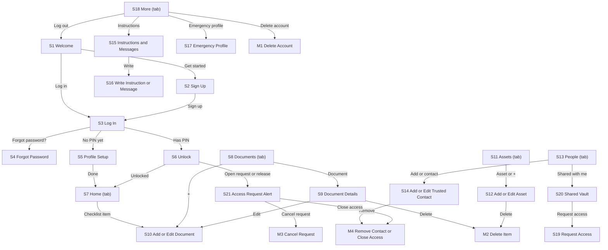

# IMPLEMENTATION_PLAN.md: LifeNest (MVP)

> **Build plan.** This is the implementation plan for the LifeNest MVP described in *PRD: LifeNest (MVP)*. It follows the course implementation-plan template. A coding agent builds the app from this file one phase at a time, test first.

---

## 0. Plan details

| Field | Value |
| --- | --- |
| App name | LifeNest (MVP) |
| Built from PRD version | v0.1 (Draft). Must be v1.0 (Approved) before Phase 1 starts. |
| Screen designs | Stitch project "LifeNest"; exported PNGs in `docs/designs/` (one file per S# and M#) |
| Plan version | v0.1 |
| Repository | github.com/[your-username]/lifenest (sample link) |
| Status | Waiting for answers (Section 18) |
| Last updated | 7 Nov 2026 |

---

## 1. Start here (instructions for the coding agent)

Before writing any code:

1. Read this whole file from top to bottom.
2. Read `docs/PRD.md`.
3. Look at the screen designs in `docs/designs/` listed in Section 7.3.
4. Check Section 18. If any clarification is still **Open** or **Proposed**, stop and ask the human. Do not start.
5. Check that the prerequisites in Section 4.2 are installed.
6. Start **Phase 1 only**. Follow Section 2 at all times.

---

## 2. Rules for the coding agent (copy word for word, do not edit)

1. **One phase at a time.** Only work on the phase the human asked for. When that phase's Definition of Done is complete, stop and wait for the human to say "Start Phase <number>".
2. **Test-driven development (TDD) for every task.** Follow the cycle in Section 12.1:
    - Write the test.
    - Run it and see it fail for the right reason.
    - Write the smallest code that makes it pass.
    - Run all tests.
    - Refactor while all tests still pass.
3. **Never cheat a test.** Never delete, skip, weaken or change a test just to make it pass. If you believe a test is wrong, stop and explain why to the human.
4. **Never break earlier work.** Every test from earlier phases must still pass before a phase is done.
5. **Build only what is planned.** Build only what is in this file and `docs/PRD.md`. Never build anything in Section 3.3 (Deferred).
6. **Ask, don't guess.** If anything is missing, unclear or contradictory, stop, add it to Section 18, and ask the human.
7. **Match the designs.** Every screen must match its design in Section 7.3: layout, order, labels, text, colours and spacing. Use the design tokens in Section 7.1. Never hard-code colours, font sizes or spacing.
8. **Every state, every screen.** Each screen must handle every state listed for it in Section 7.3 (chosen from normal, empty, loading, error, offline, success, plus any screen-specific states).
9. **Exact wording.** Use the exact labels and messages from the PRD. Never invent wording.
10. **Security first.**
    - Never put secret keys in app code, logs, test files or Git.
    - Every permission rule in Section 9 must be enforced on the server or database, never only in the app.
    - Every permission rule must have a test.
11. **Full check before "done".** Run the full check command (Section 4.3) before saying a phase is done, then add a short summary of the results to the Progress log (Section 17).
12. **Record your progress.** After each phase:
    - tick the checkboxes for that phase in this file;
    - add a row to the Progress log;
    - commit using the commit message given in the phase.
13. **No surprise libraries.** Do not add, remove or upgrade any library or tool not listed in Section 4.1 without asking the human first.
14. **Stuck rule.** If the same problem is still failing after 3 attempts, stop and report:
    - what you tried;
    - the exact error;
    - what you need from the human.
15. **Clean code.** Follow the folder structure in Section 5. Use the PRD's key terms (Section 3.4) for names in code. Keep files small and focused.

---

## 3. Project summary and scope

### 3.1 Summary

LifeNest is a private app where adults in South Africa store important documents, asset and account details, instructions, personal messages and an emergency profile in one secure vault. Owners invite up to 5 trusted contacts and choose what each may see. If the owner dies or becomes incapacitated, a trusted contact requests access with proof. The vault is released only after the admin verifies the proof **and** a 7-day waiting period passes without the owner cancelling. The owner can close access again at any time. Two small Three.js scenes (a vault door on Welcome and a readiness ring on Home) give the app a calm, premium feel, with a flat 2D fallback on slow phones.

**Platform:** Android first (React Native with Expo). iPhone and web are deferred.

### 3.2 Features in scope

| ID | Feature | Priority | Built in phase |
| --- | --- | --- | --- |
| F1 | Account and app lock | Must | 3 |
| F2 | Document vault | Must | 4 |
| F3 | Assets and accounts | Must | 5 |
| F4 | Trusted contacts | Must | 6 |
| F5 | Instructions and messages | Should | 7 |
| F6 | Emergency profile | Should | 7 |
| F7 | Access request and release | Must | 8 |
| F8 | Home dashboard and reminders | Should | 9 (placeholder Home from Phase 3) |

### 3.3 Deferred: do NOT build

- iPhone build and web version
- Push and SMS notifications (in-app plus the emails in PRD 4.5 only)
- Automatic identity or death checks through any outside service
- Owner-chosen waiting period (fixed at 7 days)
- End-to-end encryption of vault files
- Video or voice messages
- Storing passwords, PINs, or full bank or card numbers (BR3)
- Wills, legal documents generated by the app, or e-signatures
- Executor or attorney roles
- Payments or subscriptions
- Languages other than English (South Africa)
- Changing email address
- Dark mode
- Offline access to files
- 3D model files, textures or any 3D scene other than the two in Section 7.4

### 3.4 Key terms (use these names in code)

| Term (PRD 1.7) | Name in code | Meaning |
| --- | --- | --- |
| Vault | `Vault` (all rows with `owner_id` = the user) | Everything one user stores |
| Owner | `owner`, column `owner_id` | The user whose vault it is |
| Document | `Document`, table `documents` | One uploaded file with a title and category (BR1, BR2) |
| Asset | `Asset`, table `assets` | One thing the owner has or owes (BR3) |
| Trusted contact | `TrustedContact`, table `trusted_contacts` | A person invited to receive information later (BR4) |
| Access level | `AccessLevel`: `emergency`, `selected`, `full` | What a trusted contact may see (BR5) |
| Instruction | `Instruction` with `kind = 'instruction'`, table `instructions` | Practical guidance for a section |
| Personal message | `Instruction` with `kind = 'message'` | Private note to one named trusted contact |
| Emergency profile | `EmergencyProfile`, table `emergency_profiles` | Emergency contacts and key provider details |
| Access request | `AccessRequest`, table `access_requests` | A request to release the vault (BR6) |
| Waiting period | `waiting_ends_at` | 7 days after the request (BR7) |
| Release | `vault_status = 'released'` | Contacts can see the vault at their level (BR8) |
| Readiness | `Readiness`, function `get_readiness` | 8 checklist items (BR10) |
| Audit log | `AuditEntry`, table `audit_log` | Who did what, when (BR13) |

---

## 4. Tech stack, prerequisites and commands

### 4.1 Stack

| Layer | Tool | Version | Used for |
| --- | --- | --- | --- |
| Frontend | React Native + Expo, Expo Router | Latest stable Expo SDK at setup | App screens and navigation |
| Language | TypeScript (strict mode) | Bundled with Expo | All app, test and script code |
| Styling | NativeWind | Version that supports the chosen Expo SDK | Styling using tokens |
| Fonts | `@expo-google-fonts/lora`, `@expo-google-fonts/inter` | Latest | Lora (headings), Inter (everything else) |
| 3D graphics | `three` | Version required by the chosen React Three Fiber | S1 vault door and S7 readiness ring (Section 7.4) |
| 3D in React | `@react-three/fiber` (imported from `@react-three/fiber/native`) | Latest v8 or v9 that supports the Expo SDK | Writing Three.js scenes as React components |
| 3D surface | `expo-gl` | Bundled with Expo SDK | The OpenGL view React Three Fiber draws into |
| 2D fallback | `react-native-svg` | Bundled with Expo SDK | Flat readiness ring and flat vault icon |
| Files | `expo-document-picker`, `expo-image-picker`, `expo-image-manipulator` | Bundled with Expo SDK | Pick PDFs and photos; resize, compress and strip metadata (BR1) |
| Download and share | `expo-file-system`, `expo-sharing` | Bundled with Expo SDK | "Download" on S9 and S20 |
| App lock | `expo-local-authentication`, `expo-secure-store`, `expo-crypto` | Bundled with Expo SDK | Fingerprint; salted, hashed PIN on the phone (BR9); new ids with `Crypto.randomUUID()` |
| Screen protection | `expo-screen-capture` | Bundled with Expo SDK | Blocks screenshots on S9 and S20 |
| App state | React Native `AppState` | Built in | 5-minute background lock (BR9) |
| Network status | `@react-native-community/netinfo` | Latest | Offline banner |
| Data fetching and caching | `@tanstack/react-query` | v5 | Loading, caching the last lists, retries |
| Session storage | `@react-native-async-storage/async-storage` | Bundled with Expo SDK | Keeps the user logged in (Supabase session) |
| NativeWind dependencies | `tailwindcss`, `react-native-reanimated` | Versions NativeWind requires | Needed by NativeWind |
| Backend client | `@supabase/supabase-js` | v2 | Talking to Supabase |
| Backend and database | Supabase: PostgreSQL, Auth, Storage, Cron (pg_cron), pg_net, Vault | Supabase CLI latest | Data, log-in, files, scheduled jobs |
| Server functions | Supabase Edge Functions (Deno) | Supabase CLI latest | `delete-account`, `get-file-link`, `send-pending-emails` |
| Email | Resend (HTTP API, called from `send-pending-emails`) | Current API | Emails in PRD 4.5 |
| Unit and component tests | Jest (`jest-expo` preset) + React Native Testing Library | Latest | Rules, components, screens |
| Database and permission tests | pgTAP via `supabase test db` | Supabase CLI | Tables, triggers, functions, RLS |
| Integration tests | Jest + `supabase-js` against the local Supabase | — | Operations OP1–OP40 |
| End-to-end tests | Maestro | Latest | User flows on an Android emulator |
| Lint and type check | ESLint (`expo lint`), `tsc` | Bundled | Code quality |
| Secret scan | secretlint | Latest | Finds keys accidentally committed (T-NFR-6) |
| Build | Expo EAS Build | Latest | Android APK for the demo |
| Runtime | Node.js | 24 LTS | Running tools; runs `.ts` scripts directly |
| Build tool | `eas-cli` (run with `npx`) | Latest | Android APK builds |

Install Expo packages with `npx expo install <package>` so their versions match the Expo SDK. For `three` and `@react-three/fiber`, install the pair of versions that the React Three Fiber documentation lists for the React version in the chosen Expo SDK, and record both versions in the Progress log.

### 4.2 Prerequisites on the computer

- [ ] Node.js 24 LTS and npm
- [ ] Git and a GitHub account
- [ ] Docker Desktop, running (the local Supabase needs it)
- [ ] Android Studio with one Android emulator that has OpenGL ES 3 enabled (for E2E tests, the development build and the 3D scenes)
- [ ] An Android phone with Expo Go (for daily manual testing), and one older or low-end Android phone (for the 2D fallback check)
- [ ] Maestro CLI installed
- [ ] Accounts: Supabase (hosted projects in Phase 11), Expo (EAS Build), Resend (emails; a verified sending domain or Resend's test address)

### 4.3 Commands

| Purpose | Command |
| --- | --- |
| Install dependencies | `npm install` |
| Start the local backend | `npx supabase start` |
| Reset the database (migrations + seed) | `npx supabase db reset` then `npm run seed:storage` (= `node --env-file=.env scripts/seed-storage.ts`) |
| Serve server functions locally | `npx supabase functions serve --env-file supabase/functions/.env` |
| Start the app | `npx expo start` |
| Unit and component tests | `npm test` |
| Database and permission tests | `npx supabase test db` |
| Integration tests | `npm run test:integration` |
| End-to-end tests | `npx expo run:android` (once per change), then `maestro test -e SEED_TEST_PASSWORD=$SEED_TEST_PASSWORD -e SEED_TEST_PIN=$SEED_TEST_PIN .maestro/` |
| Lint | `npx expo lint` |
| Type check | `npx tsc --noEmit` |
| Unit and component tests (exact script) | `npm test` = `jest --testPathIgnorePatterns tests/integration` (preset `jest-expo`) |
| Integration tests (exact script) | `npm run test:integration` = `node --env-file=.env node_modules/jest/bin/jest.js -c jest.integration.config.js` (`testEnvironment: node`, roots `tests/integration`) |
| Run the hourly jobs once (tests and demo) | `npm run jobs:hourly` (= runs `select public.run_hourly_jobs();` against the local database) |
| **Full check (run before every "done")** | `npm run check` (runs lint, type check, `npm test`, `supabase test db` and `test:integration`). `npx supabase start` must be running, and the Edge Functions served (`npx supabase functions serve`) if `start` does not already serve them. |
| Build for release | `npx eas-cli build -p android --profile preview` (`eas.json` has a `preview` profile with `"android": { "buildType": "apk" }`) |

E2E tests (Maestro) are run at the end of each feature phase and in Phase 10. They are not part of `npm run check`, because they need the emulator.

---

## 5. Folder structure

```
lifenest/
  app/                                  Screens (Expo Router: one file per screen)
    _layout.tsx                         Root layout: fonts, providers, auth + lock redirects (Section 11)
    (auth)/welcome.tsx                  S1 Welcome
    (auth)/sign-up.tsx                  S2 Sign Up (normal + invite mode)
    (auth)/log-in.tsx                   S3 Log In
    (auth)/forgot-password.tsx          S4 Forgot Password (request mode + set-new-password mode)
    invite/[token].tsx                  Invite link handler → S2 or S3 (no UI of its own)
    profile-setup.tsx                   S5 Profile Setup
    unlock.tsx                          S6 Unlock
    (tabs)/_layout.tsx                  Tab bar
    (tabs)/index.tsx                    S7 Home
    (tabs)/documents.tsx                S8 Documents
    (tabs)/assets.tsx                   S11 Assets
    (tabs)/people.tsx                   S13 People
    (tabs)/more.tsx                     S18 More
    document/[id].tsx                   S9 Document Details
    document/edit.tsx                   S10 Add or Edit Document
    asset/edit.tsx                      S12 Add or Edit Asset
    contact/edit.tsx                    S14 Add or Edit Trusted Contact
    instructions/index.tsx              S15 Instructions and Messages
    instructions/edit.tsx               S16 Write Instruction or Message
    emergency-profile.tsx               S17 Emergency Profile
    shared/[ownerId]/index.tsx          S20 Shared Vault
    shared/[ownerId]/request.tsx        S19 Request Access
    access-alert.tsx                    S21 Access Request Alert
    modals/delete-account.tsx           M1 Delete Account
    modals/delete-item.tsx              M2 Delete Item
    modals/cancel-request.tsx           M3 Cancel Request
    modals/remove-or-close.tsx          M4 Remove Contact or Close Access
  components/                           Shared components (Section 7.2)
  components/three/                     VaultDoorScene, ReadinessRingScene, FlatRing, FlatVault, Scene3DGate (Section 7.4)
  lib/
    supabase.ts                         Supabase client (public key only)
    api/                                One file per operation group (Section 10)
    rules/                              Pure business-rule functions (BR#), no network
    lock/                               PIN hashing, fingerprint, background timer (BR9)
    files/                              File checks and photo preparation (BR1)
    messages.ts                         Every user-facing message from the PRD, in one place
  theme/tokens.ts                       Design tokens (Section 7.1)
  supabase/
    migrations/                         SQL migrations (Section 8.6)
    functions/delete-account/           Edge Function (OP6)
    functions/get-file-link/            Edge Function (OP13)
    functions/send-pending-emails/      Edge Function (OP40)
    functions/.env.example              Function secrets for local serving (never committed with real values)
    tests/                              pgTAP tests (T-SEC, T-BR, T-DB)
    seed.sql                            Seed rows (Section 8.7)
    seed/files/                         Sample "SAMPLE" PDFs and photos for seed documents
  scripts/seed-storage.ts               Uploads seed files, sets seed passwords (uses the secret key; never in the app)
  scripts/run-hourly-jobs.ts            Calls run_hourly_jobs() locally (npm run jobs:hourly)
  tests/
    unit/                               T-BR, T-AUTH, T-LOCK unit tests
    components/                         T-C, T-3D and screen-state tests
    integration/                        Operation tests against local Supabase
  .maestro/                             E2E flows (T-E2E)
  docs/PRD.md
  docs/designs/                         Exported designs: S1.png … S21.png, M1.png … M4.png
  IMPLEMENTATION_PLAN.md
  .env.example
  README.md
```

**Rule:** a new folder may only be created if it is added to this section first.

---

## 6. Environment variables and secrets

| Name | What it is | Where to get it | Public or secret | Used by |
| --- | --- | --- | --- | --- |
| `EXPO_PUBLIC_SUPABASE_URL` | Supabase address **as the phone sees it** | Local on a real phone: `http://<your computer's Wi-Fi IP>:54321`. Emulator: `http://10.0.2.2:54321`. Hosted: dashboard → Project Settings | Public | App |
| `SUPABASE_URL` | Supabase address as your computer sees it | Local: `http://127.0.0.1:54321` (from `npx supabase status`) | Public | Integration tests and scripts only |
| `EXPO_PUBLIC_SUPABASE_ANON_KEY` | Public (anon / publishable) key | Same | Public. Safe only because every table and bucket has RLS. | App |
| `EXPO_PUBLIC_LINK_BASE_URL` | Address of the hosted link-redirect page (Section 11, Section 18 #7) | GitHub Pages address you set up | Public | App (builds invite and reset links) |
| `SUPABASE_SERVICE_ROLE_KEY` | Admin (service role / secret) key | Same as the URL | **Secret** | `scripts/` and integration tests only. Edge Functions get it automatically from Supabase. |
| `RESEND_API_KEY` | Email-sending key | Resend dashboard | **Secret** | `send-pending-emails` only, stored in `supabase/functions/.env` locally and in Edge Function secrets when hosted |
| `EMAIL_MODE` | `send` or `log` | You choose | Not secret | `send-pending-emails`. Local and test: `log` (writes the email to the function log and marks it sent; never calls Resend). Hosted: `send`. |
| `EMAIL_FROM` | Sender address, e.g. `LifeNest <hello@yourdomain>` | Your verified Resend domain | Not secret | `send-pending-emails` |
| `SEED_TEST_PASSWORD` | Password for all seed test accounts | You choose it | **Secret** | `scripts/seed-storage.ts`, integration tests, Maestro |
| `SEED_TEST_PIN` | 6-digit PIN used by Maestro to set up and unlock test accounts | You choose it | **Secret** (test only) | Maestro |

`.env.example`:

```
EXPO_PUBLIC_SUPABASE_URL=http://192.168.1.10:54321
SUPABASE_URL=http://127.0.0.1:54321
EXPO_PUBLIC_SUPABASE_ANON_KEY=replace-with-anon-key
EXPO_PUBLIC_LINK_BASE_URL=https://your-username.github.io/lifenest-links
SUPABASE_SERVICE_ROLE_KEY=replace-with-service-role-key-never-commit
SEED_TEST_PASSWORD=replace-with-a-test-only-password
SEED_TEST_PIN=replace-with-6-digits
```

`supabase/functions/.env.example`:

```
RESEND_API_KEY=replace-with-resend-key-never-commit
EMAIL_MODE=log
EMAIL_FROM=LifeNest <hello@example.com>
```

Rules:

- Real values go in `.env` and `supabase/functions/.env`, which are listed in `.gitignore` and never committed.
- Only variables starting with `EXPO_PUBLIC_` may be used in the `app/`, `components/` or `lib/` folders. A test (T-NFR-6) fails if `SERVICE_ROLE` or `RESEND` appears there.
- The hourly job reads the Edge Function address and the service role key from **Supabase Vault** (`vault.decrypted_secrets`), never from a migration file. The human stores them in Phase 8 (local) and Phase 11 (hosted).
- If a new variable is needed, add it here and to the matching `.env.example` first.

---

## 7. Design system and screens

### 7.1 Design tokens (`theme/tokens.ts`)

| Token | Value | From PRD |
| --- | --- | --- |
| `color.primary` | #1F3A4D (white text on it passes 4.5:1) | 9 Primary |
| `color.accent` | #B08A4A (borders, ring fill, 3D highlights; never text on light backgrounds) | 9 Accent |
| `color.background` | #FAF8F4 | 9 |
| `color.surface` | #FFFFFF (cards) | 9 Shadows |
| `color.text` | #1E2329 | 9 |
| `color.textSecondary` | #5A6670 | 9 |
| `color.divider` | #E5E1D8 | 9 |
| `color.error` / `color.success` / `color.warning` | #B3261E / #2E7D32 / #8A5A00 | 9 |
| `color.chip.accepted` / `invited` / `requestOpen` / `released` / `rejected` | primary / #6B7280 / accent / success / error | 8.3 Status chip |
| `color.toastBackground` | #1E2329 (white text) | 8.3 Toast |
| `color.placeholder` | #E9E5DC (skeletons, initials circles) | 8.2 Loading |
| `color.badge` | #B08A4A (gold dot on the Home tab only) | 8.3 Tab bar |
| `color.three.navy` / `color.three.gold` / `color.three.light` | #1F3A4D / #B08A4A / #FFF6E5 | 9 3D elements |
| `font.heading` | Lora 600 | 9 |
| `font.family` | Inter (400, 600) | 9 |
| `font.title` | 24px Lora semibold | 9 |
| `font.section` | 18px Inter semibold | 9 |
| `font.body` | 16px Inter regular | 9 |
| `font.button` | 16px Inter semibold | 9 |
| `font.small` | 14px Inter regular | 9 |
| `space.1` / `space.2` / `space.4` / `space.6` | 4 / 8 / 16 / 24 px | 9 Spacing unit 4px |
| `space.screen` | 16px | 9 |
| `radius.card` / `radius.button` / `radius.input` / `radius.circle` | 12 / 10 / 8 / full | 9 |
| `shadow.card` | 0 1px 3px, 8% black | 9 |
| `size.button` | 48px | 9 |
| `size.touchMin` | 48px | 9 |
| `motion.reduce` | read from the phone's "Reduce motion" setting | 9 Accessibility note |
| `three.minFps` | 30 | 8.2 Low-end phone state |

### 7.2 Shared components

| Component | File | Variants and states | Used on | Tests |
| --- | --- | --- | --- | --- |
| Button | `components/Button.tsx` | primary, secondary, danger; disabled; loading | All | T-C-1 |
| TextField | `components/TextField.tsx` | normal, focused, error with message; password with eye toggle; multiline with character counter | S2–S5, S10, S12, S14, S16, S17, S19 | T-C-2 |
| PinPad | `components/PinPad.tsx` | 6 dots, number keys, delete, optional fingerprint key; error shake | S5, S6 | T-C-3 |
| Toast | `components/Toast.tsx` | one line, dark background, disappears after 3 s | S7–S17, S21 | T-C-4 |
| OfflineBanner | `components/OfflineBanner.tsx` | shown when offline: "You're offline. Changes will not be saved." | All logged-in screens | T-C-5 |
| EmptyState | `components/EmptyState.tsx` | line illustration, text, optional button | S7, S8, S11, S13, S15, S20 | T-C-6 |
| Skeleton | `components/Skeleton.tsx` | ring, line, row placeholders | S7, S8, S9, S11, S13, S15, S20 | T-C-7 |
| ConfirmModal | `components/ConfirmModal.tsx` | title, text, danger button, cancel; optional "type DELETE" field | M1–M4 | T-C-8 |
| TabBar | `app/(tabs)/_layout.tsx` | 5 icons with labels: Home, Documents, Assets, People, More; active filled navy; gold dot on Home | S7, S8, S9, S11, S13, S15, S17, S18, S20 | T-C-9 (Phase 3), T-C-9b gold dot (Phase 9) |
| CategoryRow | `components/CategoryRow.tsx` | icon, name, count; expanded / collapsed | S8, S11, S20 | T-C-10 |
| DocumentRow | `components/DocumentRow.tsx` | file-type icon, title, category, date added | S8, S9, S12, S20 | T-C-11 |
| AssetRow | `components/AssetRow.tsx` | type icon, name, provider, "•••• 1234" when last4 is set | S11, S20 | T-C-12 |
| ContactCard | `components/ContactCard.tsx` | initials circle, name, relationship, StatusChip, access level | S13, S14 | T-C-13 |
| StatusChip | `components/StatusChip.tsx` | Accepted, Invited, Expired, Declined, Request open, Released, Rejected (colours in 7.1) | S13, S14, S20, S21 | T-C-14 |
| AlertCard | `components/AlertCard.tsx` | gold left border, text, "View" button | S7 | T-C-15 |
| ChecklistRow | `components/ChecklistRow.tsx` | icon, label, tick or arrow | S7 | T-C-16 |
| Scene3DGate | `components/three/Scene3DGate.tsx` | shows the 3D scene, or the flat fallback when 3D is not supported, too slow or "Reduce motion" is on | S1, S7 | T-3D-1, T-3D-2 |
| VaultDoorScene / FlatVault | `components/three/VaultDoorScene.tsx`, `FlatVault.tsx` | Section 7.4 | S1 | T-3D-3 |
| ReadinessRingScene / FlatRing | `components/three/ReadinessRingScene.tsx`, `FlatRing.tsx` | 8 segments, `done` of 8 filled gold, centre text "5 of 8 done" | S7 | T-3D-4, T-3D-5 |

### 7.3 Screens

| ID | Screen | Route / file | Design | Who can open it (else redirect to) | Tab bar | Required states | Phase |
| --- | --- | --- | --- | --- | --- | --- | --- |
| S1 | Welcome | `/welcome` | `docs/designs/S1.png` | Logged out (else S6 or S7) | No | Normal (3D), Normal (flat fallback) | 1 |
| S2 | Sign Up | `/sign-up` (`?invite=<token>`) | S2.png, S2-invite.png | Logged out | No | Normal, Invite (email locked), Error, Offline, Success | 3 (invite mode 6) |
| S3 | Log In | `/log-in` | S3.png | Logged out | No | Normal, Error, Offline, Success (verify banner) | 3 |
| S4 | Forgot Password | `/forgot-password` | S4.png, S4-set.png | Logged out, or opened from the reset email link | No | Normal, Error, Offline, Success (both modes) | 3 |
| S5 | Profile Setup | `/profile-setup` | S5.png | Logged in, no PIN on this phone (else S6) | No | Normal, PIN mismatch, Error, Offline, Success | 3 |
| S6 | Unlock | `/unlock` | S6.png | Logged in with a PIN on this phone | No | Normal, Wrong PIN, Locked out (5 wrong), Fingerprint | 3 |
| S7 | Home | `/` (tabs) | S7.png | Logged in, unlocked | Yes | Normal, Empty (new user), Loading, Error, Offline, Low-end phone (flat ring), Success | 3 (placeholder), 9 |
| S8 | Documents | `/documents` | S8.png | Logged in, unlocked | Yes | Normal, Empty, Loading, Error, Offline, Search with no results | 4 |
| S9 | Document Details | `/document/[id]` | S9.png | Owner (else "You don't have access to this.") | Yes | Normal, Loading, Error, Offline, Not available, Screenshot blocked | 4 |
| S10 | Add or Edit Document | `/document/edit` | S10.png | Owner | No | Normal, File rejected, Uploading, Upload failed, Offline, Success | 4 |
| S11 | Assets | `/assets` | S11.png | Logged in, unlocked | Yes | Normal, Empty, Loading, Error, Offline | 5 |
| S12 | Add or Edit Asset | `/asset/edit` | S12.png | Owner | No | Normal, Validation error (BR3), Password warning (BR3), Saving, Error, Offline, Success | 5 |
| S13 | People | `/people` | S13.png | Logged in, unlocked | Yes | Normal, Empty (no contacts), Limit reached (5), Invite card, Loading, Error, Offline | 6 |
| S14 | Add or Edit Trusted Contact | `/contact/edit` | S14.png | Owner | No | Normal, Validation error, Saving, Error, Offline, Success; edit mode shows access history | 6 |
| S15 | Instructions and Messages | `/instructions` | S15.png | Owner | Yes | Normal, Empty, Loading, Error, Offline | 7 |
| S16 | Write Instruction or Message | `/instructions/edit` | S16.png | Owner | No | Normal, No recipient chosen, Saving, Error, Offline, Success | 7 |
| S17 | Emergency Profile | `/emergency-profile` | S17.png | Owner | Yes | Normal, Empty, Saving, Error, Offline, Success | 7 |
| S18 | More | `/more` | S18.png | Logged in, unlocked | Yes | Normal | 3 |
| S19 | Request Access | `/shared/[ownerId]/request` | S19.png | Accepted contact with selected or full level, no open request (else S20) | No | Normal, Uploading, Upload failed, Error, Offline, Success | 8 |
| S20 | Shared Vault | `/shared/[ownerId]` | S20.png, S20-released.png | Accepted contact of that owner (else "You don't have access to this.") | Yes | Before release (status + emergency profile if allowed), Request open, Rejected, Cancelled, Released (read-only sections), Loading, Error, Offline, Screenshot blocked | 7 (emergency part), 8 |
| S21 | Access Request Alert | `/access-alert` | S21.png, S21-released.png | Owner with an open request or a release (else S7) | No | Request open, Released, Loading, Error, Offline | 8 |
| M1 | Delete Account | `/modals/delete-account` | M1.png | Logged in | — | Normal, Deleting, Error, Offline | 3 |
| M2 | Delete Item | `/modals/delete-item` | M2.png | Owner | — | Normal, Deleting, Error, Offline | 4 (documents), 5 (assets) |
| M3 | Cancel Request | `/modals/cancel-request` | M3.png | Owner with an open request | — | Normal, Cancelling, Error, Offline | 8 |
| M4 | Remove Contact or Close Access | `/modals/remove-or-close` | M4.png | Owner | — | Normal (remove), Normal (close access), Working, Error, Offline | 6 (remove), 8 (close) |

### 7.4 Three.js scenes

Both scenes are built with `three` through `@react-three/fiber/native` on an `expo-gl` surface. They use only built-in Three.js shapes and standard materials: no model files, no textures, no network data.

| Scene | Where | What it shows | Behaviour | Fallback |
| --- | --- | --- | --- | --- |
| VaultDoorScene | S1, top half of the screen | A round navy vault door (`CylinderGeometry`) with a gold handle (`TorusGeometry`) and gold bolts, softly lit (one ambient + one directional light, warm `color.three.light`) | On open, the handle turns 90° and the door swings open 35° over 2.5 s, then rests with a slow 6° sway. Plays once per app launch. | FlatVault: an SVG of the closed door, no motion |
| ReadinessRingScene | S7, readiness card | 8 ring segments (`TorusGeometry` arcs) in a circle; the first `done` segments are gold, the rest light grey; the ring tilts 20° and turns slowly (one turn per 40 s). Centre text "5 of 8 done" is a normal React Native `Text` on top of the scene, not drawn in 3D. | When `done` changes, the new segment fills over 0.6 s (the Success state). Tapping the ring scrolls to the checklist. The scene pauses when S7 is not focused or the app is in the background. | FlatRing: an SVG ring with the same segments and text |

**When the fallback is used (rule in `lib/rules/scene3d.ts`, tested by T-3D-1):** use the flat version if any of these is true:

1. The phone's "Reduce motion" setting is on.
2. The GL surface fails to create (error caught by `Scene3DGate`).
3. The average frame rate over the first 2 seconds is below `three.minFps` (30). The decision is remembered for the rest of the app session.

Nothing important is shown only in 3D: the readiness count is always in the text, and every 3D scene has an accessibility label ("Vault door" / "Readiness: 5 of 8 done").

---
## 8. Data model and database

All tables live in the `public` schema. `users.id` is the same as the Supabase Auth user id. "Cascade" means the row is deleted when the row it points to is deleted. The 6-digit PIN is **never** stored in the database (BR9, Section 9).

### 8.1 Tables

**Table: `users`**: one person's account details.

| Column | Type | Null? | Default | Constraints | Notes |
| --- | --- | --- | --- | --- | --- |
| id | uuid | No | — | primary key; foreign key → `auth.users.id` on delete cascade | Created by a trigger on sign-up |
| email | text | No | — | unique; lower-case check | Never readable by other users (SEC2) |
| full_name | text | Yes | — | length 2–80 | Set on S5 |
| phone | text | Yes | — | check `phone ~ '^(\+27\|0)[0-9]{9}$'` | South African format |
| is_18_or_older | boolean | No | false | must be true (check) | From sign-up |
| owns_no_property_or_vehicle | boolean | No | false | — | BR10 "I don't own any" |
| last_reviewed_at | timestamptz | No | now() | — | BR11 |
| vault_status | text | No | 'normal' | check in (normal, request_open, released) | Set by triggers only (SEC2) |
| created_at | timestamptz | No | now() | | |

**Table: `documents`**: one uploaded file.

| Column | Type | Null? | Default | Constraints | Notes |
| --- | --- | --- | --- | --- | --- |
| id | uuid | No | — | primary key | Generated on the phone (`Crypto.randomUUID()`) so the file path is known before upload |
| owner_id | uuid | No | auth.uid() | foreign key → users on delete cascade | |
| title | text | No | — | length 1–80 after trimming | |
| category | text | No | — | check in the 9 categories of BR2: `identity, insurance, property, vehicles, banking_investments, debts_accounts, medical, business, other` | |
| file_path | text | No | — | — | `{owner_id}/{document_id}.{pdf\|jpg\|png}` in bucket `vault` |
| file_type | text | No | — | check in (pdf, jpg, png) | HEIC is converted to JPEG on the phone (BR1) |
| size_kb | integer | No | — | 1–10240 | BR1 |
| notes | text | Yes | — | length ≤ 500 | BR3 warning in the app |
| created_at / updated_at | timestamptz | No | now() | | `updated_at` set by trigger |

A trigger (`limit_documents`) rejects the 201st document per owner with `limit_documents` (BR1).

**Table: `assets`**: one thing the owner has or owes.

| Column | Type | Null? | Default | Constraints | Notes |
| --- | --- | --- | --- | --- | --- |
| id | uuid | No | gen_random_uuid() | primary key | |
| owner_id | uuid | No | auth.uid() | foreign key → users on delete cascade | |
| category | text | No | — | same check as `documents.category` | BR2 |
| type | text | No | — | check in (property, vehicle, policy, bank_account, card, investment, debt, recurring_payment, other) | |
| name | text | No | — | length 1–80 | |
| provider | text | Yes | — | length ≤ 80 | |
| provider_phone | text | Yes | — | length ≤ 15 | |
| reference_number | text | Yes | — | length ≤ 30; must be null when type is bank_account or card | Policy or membership number only (BR3) |
| last4 | text | Yes | — | check `last4 ~ '^[0-9]{4}$'`; allowed only when type is bank_account or card | BR3 |
| originals_location | text | Yes | — | length ≤ 200 | |
| notes | text | Yes | — | length ≤ 500 | |
| created_at | timestamptz | No | now() | | |

**Table: `asset_documents`**: asset_id → assets (cascade); document_id → documents (cascade). Primary key (asset_id, document_id). A trigger checks both rows have the same owner.

**Table: `trusted_contacts`**:

| Column | Type | Null? | Default | Constraints | Notes |
| --- | --- | --- | --- | --- | --- |
| id | uuid | No | gen_random_uuid() | primary key | |
| owner_id | uuid | No | auth.uid() | foreign key → users on delete cascade | |
| contact_user_id | uuid | Yes | — | foreign key → users on delete cascade | Set by `accept_invite` |
| name | text | No | — | length 1–80 | |
| relationship | text | No | — | length 1–40 | |
| email | text | No | — | lower-case; unique (owner_id, email); not equal to the owner's email (trigger) | BR4 |
| phone | text | Yes | — | same check as `users.phone` | |
| access_level | text | No | 'selected' | check in (emergency, selected, full) | BR5 |
| allowed_sections | text[] | No | '{}' | every item is a BR2 category or `instructions` | Used only when access_level = selected |
| status | text | No | 'invited' | check in (invited, accepted, declined, expired) | |
| invite_token | uuid | No | gen_random_uuid() | unique | In the invite link; never shown to other users |
| invite_expires_at | timestamptz | No | now() + interval '14 days' | | BR4 |
| created_at | timestamptz | No | now() | | |

A trigger (`limit_contacts`) rejects a 6th contact whose status is invited or accepted (BR4).

**Table: `instructions`**:

- id uuid primary key
- owner_id → users (cascade)
- kind text: check in (instruction, message)
- section text: a BR2 category or `general`; required when kind = instruction, null when kind = message
- recipient_id → trusted_contacts (cascade); required when kind = message, null when kind = instruction
- text text: length 1–2,000 after trimming
- created_at, updated_at

**Table: `emergency_profiles`**:

- owner_id uuid primary key → users (cascade)
- emergency_contacts jsonb: array of up to 3 objects `{name, relationship, phone}` (check function)
- medical_aid_provider text, length ≤ 80
- medical_aid_number text, length ≤ 30
- key_notes text, length ≤ 500
- share_now boolean, default false
- updated_at

**Table: `access_requests`**:

- id uuid primary key (generated on the phone, so proof file paths are known before upload)
- owner_id → users (cascade)
- contact_id → trusted_contacts (on delete set null)
- requester_id → users (on delete set null)
- reason text: check in (death, incapacity)
- proof_path text, not null: `{requester_id}/{request_id}/proof.{pdf|jpg|png}` in bucket `proof`
- requester_id_path text, not null: `{requester_id}/{request_id}/id.{pdf|jpg|png}` in bucket `proof`
- declaration_ticked boolean, must be true
- status text: check in (submitted, verified, rejected, cancelled, released, revoked), default submitted
- submitted_at timestamptz default now(); waiting_ends_at timestamptz default now() + interval '7 days'
- verified_at, released_at, closed_at, reminder_sent_at: timestamptz, optional
- admin_note text, length ≤ 300, optional
- Unique partial index: one row per owner_id where status in (submitted, verified) (BR6)

**Table: `audit_log`**:

- id bigint generated always as identity, primary key
- owner_id → users (cascade)
- actor_id → users (on delete set null); null means the admin or the system
- action text: check in (invite_sent, invite_accepted, invite_declined, request_submitted, request_verified, request_rejected, request_cancelled, released, revoked, viewed, downloaded, contact_removed)
- item_id uuid, optional
- created_at timestamptz default now()
- Rows can never be updated or deleted by any role except through account deletion (cascade).

**Table: `notifications`**:

- id uuid primary key
- recipient_id → users (on delete cascade); for an invite to a person with no account yet, this is null and `recipient_email` is set
- recipient_email text, optional
- type text: check in (invite_sent, invite_accepted, request_submitted, request_reminder, request_cancelled, request_rejected, vault_released, release_revoked, review_due)
- text text, length ≤ 200 (the exact text from PRD 4.5)
- link_target text (route, e.g. `/access-alert`)
- is_read boolean default false
- email_status text: check in (none, pending, sent, failed), default none
- created_at

### 8.2 Relationships and delete behaviour

- One user owns many documents, assets, instructions, trusted contacts and access requests, and one emergency profile. Deleting a user deletes all of these (cascade). Storage files are removed by OP6.
- Assets and documents link many-to-many through `asset_documents`. Deleting a document removes its links; the asset then shows "Document deleted" (BR12, from a `document_deleted` count kept by trigger, see 8.5).
- Deleting a trusted contact deletes their personal messages (`instructions.recipient_id` cascade) and cancels any open request they made (trigger `contact_removed_cancels_request`).
- Deleting a contact's own account deletes the `trusted_contacts` rows that point to them (cascade on `contact_user_id`), and cancels their open requests.
- Deleting `auth.users` cascades to `users`, so OP6 only needs to delete the Auth user and the storage files.

### 8.3 Status changes

| Table.column | From | To | Triggered by | Enforced by |
| --- | --- | --- | --- | --- |
| trusted_contacts.status | invited | accepted or declined | Invited person (OP25) | `accept_invite` / `decline_invite` functions only (SEC12) |
| trusted_contacts.status | invited | expired | `run_hourly_jobs()` when `invite_expires_at` has passed | Function only |
| trusted_contacts.status | expired | invited | Owner resends (OP23): new token, new 14 days | `resend_invite` function only |
| access_requests.status | submitted | verified or rejected | Admin runs `admin_verify_request` / `admin_reject_request` in the SQL editor | Functions not executable by `authenticated` (SEC21) |
| access_requests.status | submitted or verified | cancelled | Owner (OP34), contact removed, or either account deleted | `cancel_access_request` function and triggers |
| access_requests.status | verified | released | `run_hourly_jobs()` when now() ≥ `waiting_ends_at` | Function only |
| access_requests.status | released | revoked | Owner (OP35) | `revoke_release` function only |
| users.vault_status | normal → request_open → released → normal | — | Trigger `sync_vault_status` on access_requests | Users cannot write this column (SEC2) |
| notifications.is_read | false | true | Recipient opens it (OP39) | RLS: recipient may update only `is_read` |
| notifications.email_status | pending | sent or failed | `send-pending-emails` (OP40) | Service role only |

### 8.4 Indexes

- `documents (owner_id, category, created_at desc)`: Documents tab and readiness
- `documents (owner_id, lower(title) text_pattern_ops)`: search on S8
- `assets (owner_id, category)`
- `trusted_contacts (owner_id)`, `trusted_contacts (contact_user_id)`, `trusted_contacts (lower(email))`
- `instructions (owner_id, kind)`, `instructions (recipient_id)`
- `access_requests (owner_id) where status in ('submitted','verified')` (unique, BR6); `access_requests (status, waiting_ends_at)`
- `audit_log (owner_id, created_at desc)`
- `notifications (recipient_id, is_read, created_at desc)`; `notifications (email_status) where email_status = 'pending'`

### 8.5 Automatic jobs and triggers

| Name | Runs when | What it does | BR# | Test |
| --- | --- | --- | --- | --- |
| `handle_new_user` | After insert on `auth.users` | Creates the `users` row with email and is_18_or_older; if the email has invited `trusted_contacts` rows, nothing is accepted yet (acceptance is explicit, OP25) | — | T-DB-1 |
| `set_updated_at` | Before update on documents, instructions, emergency_profiles | Sets `updated_at = now()` | — | T-DB-2 |
| `limit_documents` | Before insert on documents | Raises `limit_documents` at 200 per owner | BR1 | T-BR1-3 |
| `limit_contacts` | Before insert on trusted_contacts, and before update of status to invited | Raises `limit_contacts` when the owner already has 5 invited or accepted | BR4 | T-BR4-2 |
| `no_self_invite` | Before insert on trusted_contacts | Raises `self_invite` when the email equals the owner's email | BR4 | T-BR4-3 |
| `check_access_request` | Before insert on access_requests | Checks the requester is an accepted contact of the owner with level selected or full; sets owner_id, requester_id, submitted_at, waiting_ends_at itself (ignores values sent by the app) | BR6 | T-BR6-1, T-BR6-2 |
| `sync_vault_status` | After insert / update on access_requests | Sets `users.vault_status`: request_open while a request is submitted or verified; released when released; normal otherwise | BR7, BR8 | T-BR7-3 |
| `contact_removed_cancels_request` | Before delete on trusted_contacts | Cancels any open request by that contact and notifies them ("You are no longer a trusted contact for this person.") | — | T-EDGE-1 |
| `audit_*` | After insert / update on trusted_contacts and access_requests | Writes the matching `audit_log` row | BR13 | T-BR13-1 |
| `notify_*` | After insert / update on trusted_contacts and access_requests | Creates `notifications` rows with the exact PRD 4.5 texts; `email_status = 'pending'` for the email events | 4.5 | T-DB-3 |
| `asset_link_same_owner` | Before insert on asset_documents | Rejects links between different owners | — | T-DB-4 |
| `run_hourly_jobs()` | Every hour at minute 5, scheduled by pg_cron | (1) expire invites past `invite_expires_at`; (2) send the day-3 reminder once (`reminder_sent_at` empty and now() ≥ submitted_at + 3 days); (3) release every verified request with now() ≥ `waiting_ends_at`; (4) delete proof files of requests closed more than 12 months ago (`storage.objects` rows; the file bytes are removed by the storage clean-up); (5) create `review_due` notifications for owners whose `last_reviewed_at` is 180+ days ago and who have no unread `review_due` | BR4, BR7, BR8, BR11, POPIA | T-BR4-4, T-BR7-1, T-BR7-2, T-BR11-1, T-DB-5 |
| `trigger_send_emails` | Every 5 minutes, scheduled by pg_cron | Calls the Edge Function `send-pending-emails` with `net.http_post`, reading its address and the service role key from Vault | 4.5 | T-INT-14 |

### 8.6 Migrations (in order)

1. `0001_tables.sql`: all tables, constraints and indexes in 8.1–8.4
2. `0002_helpers.sql`: `is_accepted_contact(owner uuid, viewer uuid) returns boolean`, `contact_level(owner uuid, viewer uuid) returns text`, `can_see_section(owner uuid, viewer uuid, section text) returns boolean` (true only when the vault is released and the level allows the section, BR5). All `security definer`, `set search_path = ''`.
3. `0003_rls.sql`: RLS on for every table; all policies in Section 9; column privileges for SEC2
4. `0004_triggers.sql`: all triggers in 8.5
5. `0005_functions.sql`: `get_readiness`, `confirm_review`, `accept_invite`, `decline_invite`, `resend_invite`, `get_people`, `get_shared_vault`, `get_my_open_request`, `cancel_access_request`, `revoke_release`, `get_access_history` (Section 10)
6. `0006_admin.sql`: `admin_verify_request(request_id uuid, note text)`, `admin_reject_request(request_id uuid, note text)`; `revoke execute ... from public, anon, authenticated`
7. `0007_storage.sql`: private buckets `vault` (10 MB, `application/pdf`, `image/jpeg`, `image/png`) and `proof` (10 MB, same types), and storage policies SEC17–SEC18
8. `0008_cron.sql`: `create extension if not exists pg_cron; create extension if not exists pg_net;` then `select cron.schedule('hourly_jobs', '5 * * * *', 'select public.run_hourly_jobs()');` and `select cron.schedule('send_emails', '*/5 * * * *', 'select public.trigger_send_emails()');`

### 8.7 Seed data and test accounts

- **`supabase/seed.sql`:** the users from PRD 8.4 and their data:
    - **Lerato Mokoena**: 12 documents (including 1 Identity, 2 Insurance), 9 assets (banking, insurance, investments, debts; **no** Property or Vehicles item, see Section 18 #12), contacts Kagiso (Full, accepted) and Dineo (Selected: insurance, property; invited). No emergency profile, no instructions. Readiness = **5 of 8**.
    - **Johan van Wyk**: 6 documents, 5 assets, emergency profile (share_now on), 2 instructions, 1 personal message to Anika, contact Anika (Full, accepted), 1 access request from Anika with status **released** (verified 2 days after submission, released 7 days after submission). `vault_status = released`.
    - **Anika van Wyk**: no vault content; trusted contact for Johan.
    - **Kagiso Mokoena**: no vault content; accepted Full contact for Lerato.
    - **Dineo Mokoena**: `dineo@example.com` has **no account** yet; only the invited `trusted_contacts` row exists (used to test S2 invite mode).
    - **new.user**: confirmed account with no full name, used by E2E tests to reach S5 without email verification.
- **`scripts/seed-storage.ts`:** uploads the matching files from `supabase/seed/files/` (blank templates stamped **"SAMPLE"**; never real ID documents or real policies), and sets every seed user's password to `SEED_TEST_PASSWORD`.
- **Fixed seed user ids** (so database tests can act as each user):
    - lerato = `00000000-0000-0000-0000-000000000001`
    - johan = `…0002`
    - anika = `…0003`
    - kagiso = `…0004`
    - new.user = `…0005`
    - outsider (no relationship to anyone; used for deny tests) = `…0006`
- Every seed Auth user has `raw_user_meta_data` with `is_18_or_older: true`; otherwise the `users` check fails.
- **Test accounts:** lerato@example.com (owner, normal vault), johan@example.com (owner, released vault), anika@example.com (trusted contact, released access), new.user@example.com (fresh account). Password from `SEED_TEST_PASSWORD`. PINs are set on each test phone during S5 (Maestro uses `SEED_TEST_PIN`).

---

## 9. Security and permissions

Helper functions (Section 8.6): `is_accepted_contact(owner, viewer)`, `contact_level(owner, viewer)`, `can_see_section(owner, viewer, section)`. "Released" means `users.vault_status = 'released'` for that owner.

| ID | Table / resource | Action | Who is allowed | Rule | Enforced by | Tests (allow / deny) |
| --- | --- | --- | --- | --- | --- | --- |
| SEC1 | users | read | Owner only | `id = auth.uid()`. Contacts get the owner's `full_name` only through `get_people` and `get_shared_vault`. | RLS | T-SEC-1a / 1b |
| SEC2 | users | update | Owner only | Only `full_name`, `phone`, `owns_no_property_or_vehicle`, `last_reviewed_at` (via `confirm_review`). Never `email`, `is_18_or_older`, `vault_status`. | RLS + column privileges: `revoke update on public.users from authenticated; grant update (full_name, phone, owns_no_property_or_vehicle) on public.users to authenticated;` | T-SEC-2a / 2b |
| SEC3 | documents, assets, asset_documents | create / update / delete | Owner only | `owner_id = auth.uid()` (with check) | RLS | T-SEC-3a / 3b |
| SEC4 | documents | read | Owner; or accepted contact after release | `owner_id = auth.uid() or can_see_section(owner_id, auth.uid(), category)` | RLS | T-SEC-4a / 4b (deny: before release; wrong section for selected; emergency level; outsider) |
| SEC5 | assets, asset_documents | read | Owner; or accepted contact after release | Same as SEC4, on the asset's category | RLS | T-SEC-5a / 5b |
| SEC6 | instructions (kind = instruction) | read | Owner; or accepted contact after release | `can_see_section(owner_id, auth.uid(), 'instructions')` (true for full, or selected with `instructions` ticked) | RLS | T-SEC-6a / 6b |
| SEC7 | instructions (kind = message) | read | Owner; or the named recipient after release | The recipient's `contact_user_id = auth.uid()` and released. A Full contact can **not** read a message addressed to someone else. | RLS | T-SEC-7a / 7b |
| SEC8 | instructions | create / update / delete | Owner only | For messages, the recipient must be one of the owner's accepted contacts | RLS with check + trigger | T-SEC-8a / 8b |
| SEC9 | emergency_profiles | read | Owner; or any accepted contact when `share_now` is true or the vault is released | — | RLS | T-SEC-9a / 9b |
| SEC10 | emergency_profiles | create / update | Owner only | — | RLS | T-SEC-10a / 10b |
| SEC11 | trusted_contacts | create / update / delete | Owner only | Owner may not set `status`, `contact_user_id` or `invite_token` | RLS + column privileges | T-SEC-11a / 11b |
| SEC12 | trusted_contacts | read; accept / decline | Owner; or the invited user (row whose `email` matches the caller's verified email, or `contact_user_id = auth.uid()`) | Accept and decline only through `accept_invite(token)` / `decline_invite(token)`, which check the token, the email match and expiry | RLS + security definer functions | T-SEC-12a / 12b |
| SEC13 | access_requests | create | Accepted contact with level selected or full | No other open request; values set by `check_access_request` | RLS with check + trigger | T-SEC-13a / 13b |
| SEC14 | access_requests | read | Owner (all columns except the file paths); requester (own requests) | Owners never see proof file paths; nobody sees other people's requests | RLS + column privileges | T-SEC-14a / 14b |
| SEC15 | access_requests | update | Nobody directly | Owner changes status only through `cancel_access_request` / `revoke_release`; verified and released are set only by admin functions and `run_hourly_jobs` | No update policy; functions check `owner_id = auth.uid()` | T-SEC-15a / 15b |
| SEC16 | audit_log, notifications | read; update `notifications.is_read` | audit_log: owner. notifications: recipient. | Inserts only by triggers and jobs; audit_log is never updated or deleted | RLS + column privileges | T-SEC-16a / 16b |
| SEC17 | storage `vault` | upload / delete | Owner only | `(storage.foldername(name))[1] = auth.uid()::text`; ≤ 10 MB; PDF, JPEG, PNG | Storage policies + bucket limits | T-SEC-17a / 17b |
| SEC18 | storage `vault` and `proof` | read (download) | **Nobody directly** | No select policy for `anon` or `authenticated`. Files are opened only through OP13 (`get-file-link`). `proof` is readable only by the admin in Studio. | Storage policies | T-SEC-18a / 18b |
| SEC19 | storage `proof` | upload | Requester only | Path starts with `{auth.uid()}/`; ≤ 10 MB; PDF, JPEG, PNG; no update or delete by users | Storage policies + bucket limits | T-SEC-19a / 19b |
| SEC20 | Edge Function `get-file-link` | call | Logged-in user | The function reads the document row **with the caller's token** (so SEC4 applies). Only if the row is returned does it create a signed URL (60 s) with the service role, and, for a contact, write a `viewed` or `downloaded` audit row. | Function code | T-SEC-20a / 20b |
| SEC21 | `admin_verify_request`, `admin_reject_request`, `run_hourly_jobs`, `trigger_send_emails` | execute | Admin (SQL editor) and pg_cron only | `revoke execute ... from public, anon, authenticated` | Privileges | T-SEC-21a / 21b |
| SEC22 | Edge Function `delete-account` | call | Logged-in user, for own account only | Uses the caller's token; ignores any user id in the request | Function code | T-SEC-22a / 22b |
| SEC23 | Edge Function `send-pending-emails` | call | Only with the service role key | Rejects any request whose bearer token is not the service role key | Function code | T-SEC-23a / 23b |

**On the phone (cannot be enforced by the server, tested in the app):**

- PIN: stored only as `SHA-256(salt + PIN)` in `expo-secure-store`, with a random 16-byte salt from `expo-crypto`. Never sent to Supabase, never logged (T-LOCK-1).
- 5 wrong PINs → sign out and delete the stored PIN hash (BR9, T-US3-3).
- Screenshots blocked while S9 or S20 is open (`usePreventScreenCapture`, T-S9-2).
- Files opened for viewing are written to the app's cache folder and deleted when the viewer closes. Only "Download" keeps a copy, and only after the user chooses where to share or save it (T-NFR-10).

**Always-on security checks** (tested in Phase 10):

- [ ] T-DB-6: a database test lists every table in `public` and fails if any has RLS switched off.
- [ ] T-DB-7: a database test fails if `anon` or `authenticated` has a select policy on `storage.objects` for buckets `vault` or `proof`.
- [ ] Input is checked in the app (`lib/rules`) **and** in the database (constraints in 8.1).
- [ ] Limits BR1 (200 documents), BR4 (5 contacts) and BR6 (one open request) are enforced by the database, not only in the app.
- [ ] Files are checked in the app (BR1) and by bucket size and type limits (SEC17, SEC19).
- [ ] No passwords, PINs, tokens, invite tokens or emails are written to logs (T-NFR-7).
- [ ] A secret scan (`npx secretlint "**/*"`) finds no keys (T-NFR-6).

---

## 10. Backend operations

All app operations live in `lib/api/`. Each returns either data or one of the exact messages in `lib/messages.ts`.

| ID | Operation | Who can call it | Input | Output | Rules | Errors (exact message) | Built as | Tests |
| --- | --- | --- | --- | --- | --- | --- | --- | --- |
| OP1 | Sign up | Anyone logged out | email, password, is18, agreedPrivacy, inviteToken? | Account created, verify email sent | Section 5 | "This email already has an account. Log in instead?" | Auth `signUp` (`emailRedirectTo` from Section 11) | T-US1-1, T-US1-2 |
| OP2 | Log in | Anyone logged out | email, password | Session | Section 5 | "Please verify your email first." / "Too many attempts. Try again in 15 minutes." (Supabase rate-limit error, Section 18 #5) / "Incorrect email or password." | Auth `signInWithPassword` | T-US2-1, T-US2-2, T-AUTH-2 |
| OP3 | Request password reset | Anyone | email | Always the same message | Never reveals if an account exists | "If an account exists for this email, we've sent a reset link." | Auth `resetPasswordForEmail` | T-US2-3 |
| OP4 | Set new password | User from reset link | new password | Password changed, logged in | Password rules | "At least 10 characters, including a number and a letter." | S4 `exchangeCodeForSession(code)`, then Auth `updateUser` | T-US2-4 |
| OP5 | Log out | Logged in | — | Session ended; PIN hash kept | — | — | Auth `signOut` | T-INT-1 |
| OP6 | Delete account | Logged in (self) | typed "DELETE" | Everything deleted | Section 5, BR12, SEC22 | "Something went wrong. Try again." | Edge Function `delete-account`: removes `vault/{uid}/*` and `proof/{uid}/*`, then deletes the Auth user (cascade); the app then deletes the PIN hash | T-INT-2, T-SEC-22a/b |
| OP7 | Save profile | Owner | full_name, phone? | Updated profile | — | — | Table update | T-US3-1 |
| OP8 | Set PIN | Logged in, on S5 | PIN twice, fingerprint on/off | PIN hash stored on phone | BR9 | "The PINs don't match. Try again." (Section 18 #9) | `lib/lock/pin.ts` (no network) | T-US3-1, T-LOCK-1 |
| OP9 | Unlock | Logged in, on S6 | PIN or fingerprint | Unlocked | BR9 | "Wrong PIN. 4 tries left." … / "Too many wrong PINs. Please log in again." | `lib/lock/` (no network) | T-US3-2, T-US3-3 |
| OP10 | List documents | Owner | search? | documents grouped by BR2 category | — | "No documents found." (search, Section 18 #9) | Select with RLS | T-US5-1 |
| OP11 | Upload document | Owner | file, title, category, notes? | document | BR1, BR2 | "This file can't be used. Choose a PDF or photo under 10 MB." / "Upload failed. Check your connection." / "You can store up to 200 documents." (Section 18 #9) | Phone makes the id, prepares the file (`lib/files`), uploads to `vault/{uid}/{id}.{ext}`, inserts the row; if the insert fails, removes the file | T-US4-1–3 |
| OP12 | Get document details | Owner | id | document, linked assets | — | "This document is no longer available." | Select with RLS | T-US5-2 |
| OP13 | Get file link | Owner or allowed contact | document id, purpose (view or download) | signed URL (60 s) | SEC20, BR13 | "You don't have access to this." / "This link has expired. Opening it again…" | Edge Function `get-file-link` | T-INT-3, T-SEC-20a/b |
| OP14 | Replace document file | Owner | id, new file | same document, new file | BR1 | Same as OP11 | Upload new file to a new path, update the row, then remove the old file | T-US5-3 |
| OP15 | Delete document | Owner | id | removed | BR12 | "Something went wrong. Try again." | Delete row (cascade removes links), then remove the file | T-BR12-1, T-INT-4 |
| OP16 | List assets | Owner | — | assets grouped by category, with linked-document counts and "Document deleted" flag | BR12 | — | Select with RLS | T-US6-1 |
| OP17 | Save asset | Owner | asset fields | asset | BR2, BR3 | "Enter only the last 4 digits." / "Don't store passwords here. Say where they are kept instead." (warning, not a block) | Table insert / update | T-US6-1, T-US6-2, T-BR3-1–3 |
| OP18 | Link documents to asset | Owner | asset id, document ids | links | — | — | Insert / delete on asset_documents | T-US6-3 |
| OP19 | Delete asset | Owner | id | removed | BR12 | "Something went wrong. Try again." | Table delete | T-BR12-2 |
| OP20 | Invite trusted contact | Owner | name, relationship, email, phone?, access_level, allowed_sections | contact (status invited); invite email queued | BR4, BR5 | "You can't add yourself." / "You can have up to 5 trusted contacts." / "This person is already one of your trusted contacts." (Section 18 #9) | Table insert; trigger queues the email | T-US7-1–3 |
| OP21 | Update trusted contact | Owner | id, access_level, allowed_sections, name, relationship, phone | contact | BR5 | — | Table update | T-INT-5 |
| OP22 | Remove trusted contact | Owner | id | removed; open request by them cancelled | — | — | Table delete (triggers handle the rest) | T-EDGE-1, T-INT-6 |
| OP23 | Resend invite | Owner | id | new token, new 14 days, email queued | BR4 | — | DB function `resend_invite` | T-BR4-5 |
| OP24 | Get people | Logged in | — | my contacts (with status) + "Shared with me" vaults (owner name, my level, vault status) + pending invites to me | — | — | DB function `get_people` | T-INT-7 |
| OP25 | Accept / decline invite | Invited user | token or contact id | contact accepted / declined | BR4 | "This invitation has expired. Ask the person to send it again." | DB functions `accept_invite`, `decline_invite` | T-US8-1–3 |
| OP26 | Get access history | Owner | contact id | audit entries for that contact, newest first | BR13 | — | DB function `get_access_history` | T-BR13-2 |
| OP27 | List instructions and messages | Owner | — | instructions by section; messages by recipient | — | — | Select with RLS | T-INT-8 |
| OP28 | Save instruction or message | Owner | kind, section or recipient, text | saved | — | — | Table insert / update | T-US9-1, T-US9-2 |
| OP29 | Delete instruction or message | Owner | id | removed | — | — | Table delete | T-INT-8 |
| OP30 | Get / save emergency profile | Owner | profile fields | profile | — | — | Upsert with RLS | T-US10-1 |
| OP31 | Get shared vault | Accepted contact | owner id | owner name, my level, vault status, my latest request; emergency profile if allowed; after release: allowed documents, assets, instructions and my messages | BR5, BR8 | "You don't have access to this." / "This vault no longer exists." | DB function `get_shared_vault` (security invoker, so RLS applies to every part) | T-US10-2, T-US11-3 |
| OP32 | Submit access request | Accepted contact (selected or full) | reason, proof file, ID file, declaration | request (submitted) | BR6 | "Someone has already asked for access. You'll be told when it's decided." / "Upload failed. Check your connection." | Phone makes the request id, uploads 2 files to `proof/{uid}/{request_id}/`, inserts the row; if the insert fails, the files stay (users cannot delete in `proof`) and are removed by the 12-month clean-up | T-US11-1, T-US11-2 |
| OP33 | Get my open request or release | Owner | — | requester name, reason, waiting_ends_at, status | — | — | DB function `get_my_open_request` | T-US12-1, T-US13-1 |
| OP34 | Cancel request ("I'm OK") | Owner | request id | cancelled | BR7 | — | DB function `cancel_access_request` | T-US12-2 |
| OP35 | Close access (revoke release) | Owner | — | revoked | BR8 | — | DB function `revoke_release` | T-US13-2 |
| OP36 | Get readiness | Owner | — | 8 items with done true/false, count | BR10 | — | DB function `get_readiness` | T-BR10-1 |
| OP37 | Confirm review | Owner | — | `last_reviewed_at = now()`; review_due notifications marked read | BR11 | — | DB function `confirm_review` | T-US14-2 |
| OP38 | Set "I don't own any" | Owner | true/false | updated | BR10 | — | Table update | T-BR10-2 |
| OP39 | List / mark notifications | Recipient | — / id | unread first, newest first; is_read = true | — | — | Select / update with RLS | T-INT-9 |
| OP40 | Send pending emails | pg_cron only (service role) | — | each pending notification emailed (or logged) and marked sent / failed | 4.5 | — | Edge Function `send-pending-emails` (Resend; `EMAIL_MODE=log` locally) | T-INT-14, T-SEC-23a/b |
| ADM1 | Verify request | Admin in SQL editor | request id, note? | status verified, `verified_at`, audit row | BR7 | Raises if the request is not submitted | `admin_verify_request` | T-BR7-4 |
| ADM2 | Reject request | Admin in SQL editor | request id, note | status rejected, notification to requester | — | Raises if the request is not submitted | `admin_reject_request` | T-BR7-5 |

---

## 11. Navigation rules

- **Logged out:** can only open S1–S4 and `invite/[token]`. Any other route → S1.
- **Invite link** (`invite/[token]`): stores the token on the phone. If logged out → S2 in invite mode (email filled in and locked, read from the token by `get_invite_email(token)`, which returns only the email and expiry). If logged in → S13, where the invite card shows.
- **Logged in, no PIN on this phone:** always → S5 until the PIN is set. If `full_name` is already saved (e.g. on a new phone), S5 shows it filled in.
- **Logged in with a PIN, locked:** always → S6. The app locks on start, and when it returns after more than 5 minutes in the background (BR9). The top-right lock icon on S7 locks at once.
- **Just unlocked and my vault has an open request or a release:** → S21 first (once per unlock). Otherwise → S7.
- **Tabs:** S7 Home, S8 Documents, S11 Assets, S13 People, S18 More. The tab bar is hidden on S5, S6, S10, S12, S14, S16, S19, S21 and modals. Tapping the active tab scrolls to the top.
- **Back button:** closes modals; goes back one screen; on a tab root it leaves the app. On S21 it goes to S7.
- **Login expired:** "Please log in again." → S3. Text being typed on S10, S12, S14, S16, S17 or S19 is kept on the phone (not files) and restored after logging in and unlocking.
- **Links back into the app:** `app.json` sets `scheme: "lifenest"` and `android.package: "com.example.lifenest"`. Many email apps do not open custom-scheme links, so every link in an email points to the hosted redirect page (`EXPO_PUBLIC_LINK_BASE_URL`, Section 18 #7), which opens `lifenest://invite/<token>`, `lifenest://forgot-password?...` or `lifenest://access-alert`. The Supabase client uses `flowType: 'pkce'` and AsyncStorage. When the `PASSWORD_RECOVERY` auth event fires, the redirect rules above are skipped and the user stays on S4 until the new password is saved.

Navigation map (copied from PRD 7; S4 also opens from the reset email link, and `invite/[token]` leads to S2 or S13):



---

## 12. Testing strategy

### 12.1 The TDD cycle (every task, every phase)

1. **Red:** write one test for the behaviour, using the acceptance criterion or rule. Run it. It must **fail**, and fail for the expected reason (e.g. "screen not found", not "syntax error").
2. **Green:** write the **smallest** amount of code that makes that test pass. Run **all** tests.
3. **Refactor:** clean up names, remove duplication, move code to the right folder. Run all tests again. They must still pass.
4. Repeat for the next test.

### 12.2 Test levels

| Level | What it proves | Tool | Folder | Command |
| --- | --- | --- | --- | --- |
| Unit | BR functions in `lib/rules`, PIN logic in `lib/lock`, file checks in `lib/files` give the right answers | Jest | `tests/unit/` | `npm test` |
| Component | Components and screens show the right things in every state, with fake data | Jest + React Native Testing Library; `lib/api` mocked; `@react-three/fiber/native` and `expo-gl` mocked (scenes are tested through their props and the fallback choice, not by drawing pixels) | `tests/components/` | `npm test` |
| Database and permissions | Constraints, triggers, functions, jobs and RLS allow and deny correctly | pgTAP | `supabase/tests/` | `npx supabase test db` |
| Integration | OP1–OP40 work against the local Supabase and local Edge Functions | Jest + supabase-js | `tests/integration/` | `npm run test:integration` |
| End-to-end | User flows from PRD 7 work on a real build | Maestro on Android emulator; every flow starts with `appId: com.example.lifenest` | `.maestro/` | `maestro test -e SEED_TEST_PASSWORD=$SEED_TEST_PASSWORD -e SEED_TEST_PIN=$SEED_TEST_PIN .maestro/` |
| Manual | Screens match designs; real-phone checks (camera, fingerprint, 3D smoothness, 2D fallback, emails) | Human | Step 5 of each phase | — |

### 12.3 Test IDs

Every automated test name starts with its ID, for example `it('T-US1-2 shows the already-registered message', …)`. Run one test with `npm test -- -t "T-US1-2"`.

| Prefix | Comes from |
| --- | --- |
| T-US#-# | PRD acceptance criteria |
| T-BR#-# | Business rules |
| T-SEC-#a / b | Section 9 |
| T-SETUP-# | Phase 1 tool and setup checks |
| T-AUTH-# | Account rules (PRD Section 5) |
| T-LOCK-# | PIN and app-lock rules on the phone (BR9) |
| T-3D-# | Three.js scenes and the 2D fallback (Section 7.4) |
| T-DB-# | Triggers, jobs and constraints not covered by a BR |
| T-NAV-# | Navigation rules (Section 11) |
| T-S#-# / T-M#-# | Extra states or behaviour of one screen or modal |
| T-C-# | Section 7.2 components |
| T-INT-# | Operations not covered by a T-US test |
| T-EDGE-# | PRD 6.2 edge cases |
| T-E2E-# | PRD 7 flows |
| T-NFR-# | PRD 12 quality requirements |
| T-REL-# | Release checks (Phase 11) |

### 12.4 Test data rules

- Tests never depend on each other or on the order they run in.
- pgTAP tests run inside a transaction and roll back; each starts from the seed data. To act as a seed user: `set local role authenticated; select set_config('request.jwt.claims', json_build_object('sub', '<seed uuid>', 'role', 'authenticated', 'email', '<seed email>')::text, true);`
- To test time-based rules (waiting period, reminders, invite expiry, 180-day review), tests move the row's timestamps into the past (e.g. `submitted_at = now() - interval '8 days'`) and then call `run_hourly_jobs()` directly. Tests never wait for real time to pass.
- Integration tests create their own users with random emails and delete them at the end.
- Component tests use the PRD 8.4 sample data (Lerato, Johan, Anika, Dineo) as fake data.
- Every test file is a blank sample stamped "SAMPLE". No real personal data, ID documents or real passwords are used anywhere in tests.
- `send-pending-emails` always runs with `EMAIL_MODE=log` in tests; no real email is ever sent by a test.

### 12.5 Coverage rules

- 100% of PRD acceptance criteria have an automated test, except camera, fingerprint and real-email steps, which are manual (marked "manual").
- 100% of BR1–BR13 have unit or database tests.
- 100% of SEC1–SEC23 have an allow and a deny test (SEC18 and SEC21 are deny-for-users and allow-for-admin).
- 100% of PRD edge cases have a test.
- At least 90% line coverage for `lib/rules/` and `lib/lock/`.

---
## 13. Phases

### 13.0 Phase overview

| Phase | Name | Features | Screens | Main tests |
| --- | --- | --- | --- | --- |
| 1 | Foundation | — | S1 (with the Three.js vault door) | T-C-1–8, T-3D-1–3, sample test at each level |
| 2 | Data and security | — | — | T-SEC-1–19, 21, T-DB-1–5, T-BR1, 2, 4–8, 10–13 (database parts) |
| 3 | Accounts and app lock | F1 | S2, S3, S4, S5, S6, S18, M1, tab bar + placeholders | T-US1, T-US2, T-US3, T-AUTH-1–3, T-LOCK-1–3, T-INT-1–2, T-SEC-22, T-C-9, T-NAV-1 |
| 4 | Document vault | F2 | S8, S9, S10, M2 (documents) | T-US4, T-US5, T-BR1, T-BR2, T-BR12-1, T-SEC-20, T-EDGE-4, T-C-10–11 |
| 5 | Assets and accounts | F3 | S11, S12, M2 (assets) | T-US6, T-BR3, T-BR12-2, T-C-12 |
| 6 | Trusted contacts | F4 | S2 (invite mode), S13, S14, M4 (remove) | T-US7, T-US8, T-BR4, T-BR5-2, T-BR13-2, T-EDGE-5, T-INT-14, T-SEC-23, T-C-13–14 |
| 7 | Instructions, messages and emergency profile | F5, F6 | S15, S16, S17, S20 (before release) | T-US9, T-US10, T-INT-8 |
| 8 | Access request and release | F7 | S19, S20 (all states), S21, M3, M4 (close access) | T-US11, T-US12, T-US13, T-BR6–8, T-EDGE-1–3, T-NAV-2 |
| 9 | Home dashboard and reminders | F8 | S7 (with the Three.js readiness ring) | T-US14, T-BR10, T-BR11-2, T-3D-4–5, T-C-9b, T-C-15–16 |
| 10 | Hardening | — | All | T-EDGE-6–7, T-NFR-1–7, 10, T-DB-6–7, T-E2E-1–4 |
| 11 | Release | — | All | Full suite on a clean install |

---

### Phase 1: Foundation

**Goal:** The app opens on S1 Welcome with the Three.js vault-door animation (or its flat fallback), matching its design, and every test level has one passing example test.

**Covers:** Screens S1 · Components Button, TextField, PinPad, Toast, OfflineBanner, EmptyState, Skeleton, ConfirmModal, Scene3DGate, VaultDoorScene, FlatVault · Section 7.4

**Starts when:** All of Section 18 is Answered and the human says "Start Phase 1".

**Step 1: Write the failing tests first (Red)**

| Test ID | Level | File | What it checks |
| --- | --- | --- | --- |
| T-SETUP-1 | Unit | `tests/unit/tokens.test.ts` | Tokens match Section 7.1 exactly (e.g. `color.primary` is #1F3A4D, `size.button` is 48) |
| T-C-1 | Component | `tests/components/Button.test.tsx` | Primary, secondary and danger render; disabled cannot be pressed; loading shows a spinner and blocks presses; height is 48 |
| T-C-2 | Component | `TextField.test.tsx` | Shows error text and red border when `error` is set; eye icon toggles password visibility; multiline shows "12 / 2,000" counter |
| T-C-3 | Component | `PinPad.test.tsx` | 6 dots fill as digits are pressed; delete removes one; completes after 6 digits; fingerprint key shown only when enabled |
| T-C-4 | Component | `Toast.test.tsx` | Shows the text and disappears after 3 seconds |
| T-C-5 | Component | `OfflineBanner.test.tsx` | Visible with the exact text when offline; hidden when online |
| T-C-6 | Component | `EmptyState.test.tsx` | Shows text and an optional button that calls its action |
| T-C-7 | Component | `Skeleton.test.tsx` | Renders ring, line and row shapes |
| T-C-8 | Component | `ConfirmModal.test.tsx` | Danger button calls confirm; Cancel calls cancel; with `typeToConfirm="DELETE"` the danger button stays disabled until DELETE is typed |
| T-3D-1 | Unit | `tests/unit/scene3d.test.ts` | `useFlatFallback({ reduceMotion, glFailed, avgFps })` is true when reduce motion is on, GL failed, or average fps < 30; false otherwise |
| T-3D-2 | Component | `Scene3DGate.test.tsx` | With `@react-three/fiber/native` mocked: renders the 3D child normally; renders the flat child when reduce motion is on or the canvas reports an error; keeps the choice for the session |
| T-3D-3 | Component | `VaultDoorScene.test.tsx` | Scene has accessibility label "Vault door"; uses only the shapes in 7.4 (cylinder door, torus handle) with `color.three.*` tokens; animation plays once per launch (second mount starts at rest) |
| T-S1-1 | Component | `tests/components/Welcome.test.tsx` | S1 shows the vault scene (or FlatVault), the LifeNest wordmark, the pitch, "Get started" and "Log in", which go to S2 and S3 |
| T-SETUP-2 | Database | `supabase/tests/000_setup.test.sql` | pgTAP runs: `select has_schema('public')` passes |
| T-SETUP-3 | Integration | `tests/integration/health.test.ts` | The app's Supabase client connects to the local backend |
| T-SETUP-4 | E2E | `.maestro/00_launch.yaml` | The app launches and S1 shows "Get started" |

- [ ] All tests above are written, run, and fail for the expected reason.

**Step 2: Backend (Green)**

- [ ] `npx supabase init`; `npx supabase start` works; pgTAP extension enabled for tests.
- [ ] `lib/supabase.ts` creates the client from the `EXPO_PUBLIC_` variables only, with AsyncStorage for the session and `flowType: 'pkce'`.

**Step 3: Frontend (Green)**

- [ ] Create the Expo app with TypeScript (strict) and Expo Router. Add every library in Section 4.1 with `npx expo install` (and the matching `three` + `@react-three/fiber` pair). Set `scheme` and `android.package` in `app.json` (Section 11).
- [ ] `theme/tokens.ts` with every token in 7.1, wired into NativeWind. Load Lora and Inter.
- [ ] Build the 8 components T-C-1 to T-C-8.
- [ ] Build `lib/rules/scene3d.ts`, `Scene3DGate`, `VaultDoorScene` and `FlatVault` exactly as in Section 7.4.
- [ ] Build S1 Welcome to `docs/designs/S1.png`.
- [ ] Add `.env.example`, `supabase/functions/.env.example`, `.gitignore` (includes both `.env` files), the `npm run check` and `test:integration` scripts, and a README with setup steps.

**Step 4: Refactor and full check**

- [ ] Code cleaned up; names use PRD key terms.
- [ ] `npm run check` passes. `maestro test .maestro/00_launch.yaml` passes (T-SETUP-4).

**Step 5: Manual checks (human)**

- [ ] S1 on a real phone (Expo Go) matches S1.png side by side; the door opens smoothly once.
- [ ] With "Remove animations" (Reduce motion) switched on in the phone's Accessibility settings, S1 shows the flat vault.
- [ ] `.env` and `supabase/functions/.env` are not shown by `git status`.

**Definition of Done**

- [ ] Every test in Step 1 passes.
- [ ] Exact installed versions (including `three`, `@react-three/fiber`, `expo-gl`) are recorded in the Progress log.
- [ ] Manual checks ticked by the human.
- [ ] Progress log updated.

**Commit message:** `Phase 1: Foundation`

**STOP.** Wait for the human to say "Start Phase 2".

---

### Phase 2: Data and security

**Goal:** The whole database exists with every rule, trigger, job and permission enforced and tested, and seed data loads with one command.

**Covers:** Section 8 (all), Section 9 SEC1–SEC19, SEC21 (SEC20, SEC22, SEC23 are Edge Functions, tested in Phases 4, 3 and 6) · Rules BR1, BR2, BR4–BR8, BR10–BR13 (database parts) · Operations ADM1, ADM2 and the database functions in 8.6

**Starts when:** Phase 1 is complete and the human says "Start Phase 2".

**Step 1: Write the failing tests first (Red)**

All tests in this phase are pgTAP tests in `supabase/tests/`.

| Test ID | File | What it checks |
| --- | --- | --- |
| T-DB-1 | `010_tables.test.sql` | Every table and column in 8.1 exists with the right type, null rule and default; signing up creates a `users` row |
| T-DB-2 | `020_triggers.test.sql` | `updated_at` changes on update of documents, instructions and emergency_profiles |
| T-DB-3 | same | Each event in PRD 4.5 creates a notification with the exact text, the right recipient and `email_status = 'pending'` for email events |
| T-DB-4 | same | Linking an asset to another owner's document is rejected |
| T-DB-5 | same | `run_hourly_jobs` removes proof files of requests closed more than 12 months ago and keeps newer ones |
| T-BR1-3 | `030_rules.test.sql` | The 201st document for one owner raises `limit_documents` |
| T-BR2-1 | same | A document or asset with a category outside the 9 in BR2 is rejected |
| T-BR3-1 | same | `last4` "123", "12345", "12a4" rejected; "1234" accepted for bank_account and card only; `reference_number` rejected for bank_account and card |
| T-BR4-2 | same | A 6th invited-or-accepted contact raises `limit_contacts`; declined and expired ones do not count |
| T-BR4-3 | same | Inviting your own email raises `self_invite`; the same email twice for one owner is rejected |
| T-BR4-4 | same | `run_hourly_jobs` marks invites older than 14 days as expired; `accept_invite` with an expired token fails |
| T-BR5-1 | `040_access.test.sql` | `can_see_section` matrix: before release → false for every level; after release → emergency false for all sections, selected true only for ticked sections, full true for all |
| T-BR6-1 | same | Only an accepted contact with selected or full can insert a request; emergency, invited, declined and outsider cannot |
| T-BR6-2 | same | A second open request for the same owner is rejected; after the first is cancelled, a new one is allowed; values for owner_id, status and waiting_ends_at sent by the user are ignored |
| T-BR7-1 | same | `run_hourly_jobs` releases a request only when it is verified **and** `waiting_ends_at` has passed; a submitted request past 7 days stays submitted; a verified request inside 7 days stays verified |
| T-BR7-2 | same | The day-3 reminder notification is created once, after 3 days, and not again on the next run |
| T-BR7-3 | same | `users.vault_status` follows the request: request_open → released → normal after revoke; normal after cancel |
| T-BR7-4 | same | `admin_verify_request` sets verified and `verified_at`, writes an audit row; fails on a cancelled request |
| T-BR7-5 | same | `admin_reject_request` sets rejected, stores the note, notifies the requester with "We could not verify the documents you sent. Please upload clearer copies." |
| T-BR8-1 | same | After release, **every** accepted contact (not only the requester) can read at their level; invited contacts cannot |
| T-BR8-2 | same | `revoke_release` by the owner removes all contact access at once and notifies every contact |
| T-BR10-1 | `050_functions.test.sql` | `get_readiness` for seed Lerato returns 5 of 8 with the right items; each item flips when its data is added |
| T-BR11-1 | same | `run_hourly_jobs` creates one `review_due` notification when `last_reviewed_at` is 180+ days old; `confirm_review` resets it |
| T-BR12-1 | same | Deleting a document removes its asset links; the asset reports one deleted link |
| T-BR13-1 | same | Invite, accept, decline, submit, verify, reject, cancel, release and revoke each write exactly one audit row with the right actor |
| T-SEC-1a … T-SEC-19b, T-SEC-21a/b | `060_rls.test.sql`, `070_storage.test.sql` | One allow and one deny test per row in Section 9 (except SEC20, SEC22, SEC23), acting as Lerato, Johan, Anika, Kagiso and the outsider. Storage tests here check the folder and no-read rules; size and type limits are tested in Phase 4 (T-INT-10). |

- [ ] All tests above are written, run, and fail for the expected reason.

**Step 2: Backend (Green)**

- [ ] Migrations `0001` to `0008` exactly as in Section 8.6, applied with `npx supabase db reset`.
- [ ] `supabase/seed.sql`, `supabase/seed/files/` and `scripts/seed-storage.ts` load the seed data in 8.7 (`npm run seed:storage`).
- [ ] `scripts/run-hourly-jobs.ts` and the `jobs:hourly` npm script.

**Step 3: Frontend (Green)**

- [ ] None in this phase.

**Step 4: Refactor and full check**

- [ ] Every function has `set search_path = ''`. These are `security definer` (they must work past RLS, and each checks the caller itself): the helpers in `0002`, all triggers, `accept_invite`, `decline_invite`, `get_invite_email`, `resend_invite`, `cancel_access_request`, `revoke_release`, `confirm_review`, `run_hourly_jobs`, `trigger_send_emails`, `admin_verify_request`, `admin_reject_request`. These are security invoker, so RLS applies: `get_readiness`, `get_people`, `get_shared_vault`, `get_my_open_request`, `get_access_history`.
- [ ] `npm run check` passes (includes all Phase 1 tests).

**Step 5: Manual checks (human)**

- [ ] In the local Supabase Studio, the tables, the seed users and their data are visible; Johan's request shows as released.
- [ ] RLS shows "enabled" on every table; buckets `vault` and `proof` are private.
- [ ] In the SQL editor, running `select public.admin_verify_request('<id>', null);` as `postgres` works; the same call through the app's anon key is refused.

**Definition of Done**

- [ ] Every test in Step 1 passes; all Phase 1 tests still pass.
- [ ] Reset + seed works from scratch with two commands.
- [ ] Progress log updated.

**Commit message:** `Phase 2: Data and security`

**STOP.** Wait for the human to say "Start Phase 3".

---

### Phase 3: Accounts and app lock (F1)

**Goal:** A person can sign up, verify their email, log in, reset a forgotten password, set up their profile and PIN, unlock with PIN or fingerprint, log out and delete their account.

**Covers:** Features F1 · Stories US1, US2, US3 · Screens S2, S3, S4, S5, S6, S18, M1; S7 placeholder · Rules BR9 · Operations OP1–OP9 · Permissions SEC22

**Starts when:** Phase 2 is complete and the human says "Start Phase 3".

**Step 1: Write the failing tests first (Red)**

| Test ID | Level | File | What it checks |
| --- | --- | --- | --- |
| T-AUTH-1 | Unit | `tests/unit/password.test.ts` | "abcdefghi1" passes; "abcdefghij" (no number), "1234567890" (no letter) and "abc12" (too short) fail |
| T-US1-1 | Component + Integration | `SignUp.test.tsx`, `auth.int.test.ts` | Valid form + both boxes ticked → account created → S3 with "Check your email and tap the link to verify your account." |
| T-US1-2 | Component + Integration | same | Existing email → "This email already has an account. Log in instead?" with a "Log in" link |
| T-US1-3 | Component | `SignUp.test.tsx` | Either box unticked or invalid password → "Sign up" disabled; leaving the password field shows the red border and "At least 10 characters, including a number and a letter." |
| T-US2-1 | Component + Integration | `LogIn.test.tsx`, `auth.int.test.ts` | Verified user logs in → S5 if no PIN on this phone, otherwise S6 |
| T-US2-2 | Component + Integration | same | Unverified user → "Please verify your email first." and "Resend email" |
| T-US2-3 | Component + Integration | `ForgotPassword.test.tsx` | Any email → "If an account exists for this email, we've sent a reset link." (same for unknown emails) |
| T-US2-4 | Component + Integration | same | Opened from the reset link → set-new-password mode; a valid new password logs the user in → S6 (or S5 if no PIN) |
| T-AUTH-2 | Component | `LogIn.test.tsx` | Auth rate-limit error → "Too many attempts. Try again in 15 minutes."; wrong password → "Incorrect email or password." |
| T-AUTH-3 | Unit | `tests/unit/session.test.ts` | A session older than 30 days is signed out on app start; a newer one is kept |
| T-US3-1 | Component + Integration | `ProfileSetup.test.tsx`, `profile.int.test.ts` | Full name + same PIN twice + "Done" → name saved, PIN hash stored → S7; different PINs → "The PINs don't match. Try again." |
| T-US3-2 | Component | `Unlock.test.tsx`, `tests/unit/lockTimer.test.ts` | App back from background after > 5 minutes → S6; after < 5 minutes → stays; correct PIN or fingerprint → unlocks |
| T-US3-3 | Component | `Unlock.test.tsx` | 5 wrong PINs → "Too many wrong PINs. Please log in again." → signed out, PIN hash deleted → S3; each wrong PIN shows "Wrong PIN. 4 tries left." (3, 2, 1) |
| T-LOCK-1 | Unit | `tests/unit/pin.test.ts` | The stored value is a salted SHA-256 hash, never the PIN; two users with the same PIN get different hashes; the PIN is never passed to any `lib/api` function |
| T-LOCK-2 | Component | `Unlock.test.tsx` | "Forgot PIN?" signs out and goes to S3; after log-in the user sets a new PIN on S5 |
| T-LOCK-3 | Component | `ProfileSetup.test.tsx` | Fingerprint switch is shown only when the phone has enrolled biometrics (`expo-local-authentication` mocked) |
| T-C-9 | Component | `TabBar.test.tsx` | 5 tabs with labels in the right order; the active tab is filled navy; each opens its tab |
| T-INT-1 | Integration | `auth.int.test.ts` | Log out ends the session; protected routes redirect to S1; the PIN hash stays (same person may log in again) |
| T-INT-2 | Integration | `deleteAccount.int.test.ts` | Delete account removes the Auth user, the users row, all vault rows, `vault/{uid}` and `proof/{uid}` files, and the contact rows that pointed to them |
| T-SEC-22a / 22b | Integration | same | A user can delete only their own account; a request containing someone else's id still deletes only the caller |
| T-M1-1 | Component | `DeleteAccount.test.tsx` | "Delete" stays disabled until DELETE is typed |
| T-NAV-1 | Component | `navigation.test.tsx` | Redirect rules in Section 11 for logged-out, no-PIN, locked and unlocked users |

- [ ] All tests above are written, run, and fail for the expected reason.

**Step 2: Backend (Green)**

- [ ] Supabase Auth settings in `supabase/config.toml`:
    - `[auth] minimum_password_length = 10` and `password_requirements = "letters_digits"`;
    - `[auth.email] enable_confirmations = true` and `otp_expiry = 3600` (reset link works for 1 hour);
    - `[auth] site_url` = the link-redirect page, and `additional_redirect_urls` includes `lifenest://**`, the redirect page address and your Expo Go `exp://**` address;
    - `[auth.rate_limit]` left at its defaults (this is the server-side protection behind T-AUTH-2).
- [ ] Edge Function `supabase/functions/delete-account` (OP6). It reads the caller from the request token, removes their files from both buckets, then deletes the Auth user.

**Step 3: Frontend (Green)**

- [ ] `lib/rules/password.ts`; `lib/lock/pin.ts`, `biometrics.ts`, `lockTimer.ts`; `lib/api/auth.ts`, `profile.ts` (OP1–OP9), with messages from `lib/messages.ts`.
- [ ] S2 Sign Up (normal mode), S3 Log In (with verify banner and resend link), S4 Forgot Password (both modes), S5 Profile Setup, S6 Unlock, each built to its design with every state in 7.3.
- [ ] Auth and lock redirects in `app/_layout.tsx` (Section 11), including the `PASSWORD_RECOVERY` exception, the 30-day sign-out (T-AUTH-3) and the 5-minute background lock.
- [ ] Tab layout with TabBar (T-C-9), plus placeholder routes for S7, S8, S11 and S13 that show only the screen title. Each is replaced in its own phase.
- [ ] S18 More: "Instructions and messages" and "Emergency profile" rows (hidden until Phase 7), "Change PIN" (→ S5 PIN part), "Privacy Notice" (opens the hosted page in the phone's browser, Section 18 #10), "Log out", "Delete account" → M1.
- [ ] M1 Delete Account using ConfirmModal with `typeToConfirm="DELETE"`.

**Step 4: Refactor and full check**

- [ ] `npm run check` passes.
- [ ] `maestro test .maestro/01_setup_first_document.yaml` passes up to S7 (T-E2E-1, part 1: sign up with a new email and see the verify banner; then log in as new.user@example.com, set name and `SEED_TEST_PIN`, reach S7).

**Step 5: Manual checks (human)**

- [ ] On a real phone: sign up, open the verification email in the local email inbox (URL from `npx supabase status`), log in, set a PIN, switch on fingerprint.
- [ ] Send the app to the background for 6 minutes; it asks for the PIN or fingerprint.
- [ ] Reset a password from the email link and log in with the new one.
- [ ] Delete a test account and confirm in Supabase Studio that everything is gone.
- [ ] S2–S6, S18 and M1 match their designs.

**Definition of Done**

- [ ] Every test in Step 1 passes; all earlier tests still pass.
- [ ] All states for S2–S6 and M1 shown.
- [ ] Manual checks ticked; Progress log updated.

**Commit message:** `Phase 3: Accounts and app lock (F1)`

**STOP.** Wait for the human to say "Start Phase 4".

---

### Phase 4: Document vault (F2)

**Goal:** An owner uploads PDFs and photos into categories, finds and opens them, replaces and deletes them, and files are only ever opened through short-lived links.

**Covers:** Features F2 · Stories US4, US5 · Screens S8, S9, S10, M2 (documents) · Rules BR1, BR2, BR12 · Operations OP10–OP15 · Permissions SEC17, SEC20 · Edge case 4 (upload while offline)

**Starts when:** Phase 3 is complete and the human says "Start Phase 4".

**Step 1: Write the failing tests first (Red)**

| Test ID | Level | File | What it checks |
| --- | --- | --- | --- |
| T-BR1-1 | Unit | `tests/unit/fileCheck.test.ts` | Accepts PDF, JPG, PNG, HEIC ≤ 10 MB; rejects others with "This file can't be used. Choose a PDF or photo under 10 MB." |
| T-BR1-2 | Unit | `tests/unit/preparePhoto.test.ts` | Photos are resized so the longest side is 2,000 px, saved as JPEG under 1 MB (quality stepped down if needed), with `exif: false`; HEIC becomes JPEG; PDFs are passed through unchanged (image library mocked; options checked) |
| T-US4-1 | Component + Integration | `AddDocument.test.tsx`, `documents.int.test.ts` | Choose file → title → category → "Save" → uploaded → S8 with the document under its category and toast "Saved" |
| T-US4-2 | Component | `AddDocument.test.tsx` | Wrong type or > 10 MB → the exact BR1 message |
| T-US4-3 | Component + Integration | same | Upload fails → "Upload failed. Check your connection." with "Try again"; file, title and category kept; no orphan file left in storage |
| T-S10-1 | Component | same | Opened from a checklist item with `?category=identity` → Identity already chosen |
| T-S10-2 | Component | same | Camera or gallery permission refused → "Allow camera or photo access in your phone settings." with "Open settings" (Section 18 #9) |
| T-US5-1 | Component | `Documents.test.tsx` | Grouped by category with counts; typing 2+ characters filters by title across categories; no match → "No documents found." |
| T-US5-2 | Component + Integration | `DocumentDetails.test.tsx` | S9 shows preview, category, notes, date added and linked assets; preview loads through OP13 |
| T-US5-3 | Component + Integration | same | "Replace file" → new file uploaded, row updated, old file removed; title, category and links unchanged |
| T-S9-1 | Component | same | "Download" calls OP13 with purpose download and opens the phone's share sheet |
| T-S9-2 | Component | same | `usePreventScreenCapture` is active while S9 is open and released when it closes |
| T-BR12-1b | Component + Integration | `DeleteItem.test.tsx`, `documents.int.test.ts` | "Delete" → M2 → row and file removed → back to S8 with "Deleted" |
| T-INT-3 | Integration | `fileLink.int.test.ts` | OP13 returns a working URL that stops working after 60 seconds |
| T-SEC-20a / 20b | Integration | same | Owner gets a link; an outsider, an unreleased contact, and a selected contact asking for a section they do not have all get "You don't have access to this." |
| T-INT-4 | Integration | `documents.int.test.ts` | OP15 removes the storage file |
| T-INT-10 | Integration | `storage.int.test.ts` | Uploading a file over 10 MB or of another type to `vault` or `proof` is rejected by Storage; uploading to another user's folder is rejected |
| T-EDGE-4 | Component | `AddDocument.test.tsx` | Offline → offline banner, "Save" disabled, form kept; nothing uploaded |
| T-C-10 / 11 | Component | `CategoryRow`, `DocumentRow` tests | Each component's variants in 7.2 |

- [ ] All tests above are written, run, and fail for the expected reason.

**Step 2: Backend (Green)**

- [ ] Edge Function `supabase/functions/get-file-link` (OP13, SEC20): reads the document with the caller's token; if found, creates a 60-second signed URL with the service role; if the caller is not the owner, inserts an `audit_log` row (`viewed` or `downloaded`).
- [ ] Bucket limits confirmed against migration `0007`.

**Step 3: Frontend (Green)**

- [ ] `lib/files/check.ts`, `preparePhoto.ts`; `lib/api/documents.ts`, `fileLink.ts`.
- [ ] S8 Documents (CategoryRow, DocumentRow, search after 300 ms of no typing, "+" button), S9 Document Details (PDF or image preview from the signed link, cached file deleted on close), S10 Add or Edit Document (gallery, camera, file picker), M2 Delete Item. Build each to its design with every state.

**Step 4: Refactor and full check**

- [ ] `npm run check` passes.
- [ ] `maestro test .maestro/01_setup_first_document.yaml` extended to: tap "Add an ID document" placeholder link on S7 → S10 → pick a sample image pushed to the emulator → title "My ID" → "Save" → S8 shows it (T-E2E-1 complete except the readiness count, finished in Phase 9).

**Step 5: Manual checks (human)**

- [ ] On a real phone: upload a PDF, a gallery photo and a camera photo.
- [ ] In Supabase Studio, an uploaded photo is under 1 MB with the longest side 2,000 px.
- [ ] Try to take a screenshot on S9: it is blocked.
- [ ] S8, S9, S10 and M2 match their designs.

**Definition of Done**

- [ ] Every test in Step 1 passes; all earlier tests still pass.
- [ ] Manual checks ticked; Progress log updated.

**Commit message:** `Phase 4: Document vault (F2)`

**STOP.** Wait for the human to say "Start Phase 5".

---

### Phase 5: Assets and accounts (F3)

**Goal:** An owner records properties, vehicles, policies, accounts, investments, debts and recurring payments, links documents to them, and never stores full account or card numbers.

**Covers:** Features F3 · Stories US6 · Screens S11, S12, M2 (assets) · Rules BR2, BR3, BR12 · Operations OP16–OP19

**Starts when:** Phase 4 is complete and the human says "Start Phase 5".

**Step 1: Write the failing tests first (Red)**

| Test ID | Level | File | What it checks |
| --- | --- | --- | --- |
| T-BR3-1b | Unit | `tests/unit/assetRules.test.ts` | `last4` accepts exactly 4 digits; anything else gives "Enter only the last 4 digits." |
| T-BR3-2 | Unit | same | Notes containing "password" or "PIN" (any case, whole word) return the warning "Don't store passwords here. Say where they are kept instead."; "pinned" and "spinach" do not |
| T-BR3-3 | Unit | same | The form shows "Last 4 digits" only for bank_account and card, and "Policy or membership number" only for the other types |
| T-US6-1 | Component + Integration | `AddAsset.test.tsx`, `assets.int.test.ts` | Category + type + name + provider → "Save" → S11 shows it under its category |
| T-US6-2 | Component | `AddAsset.test.tsx` | Bank account with 3 or 5 digits → "Enter only the last 4 digits." and "Save" disabled |
| T-US6-3 | Component + Integration | same | "Link a document" → pick documents → listed on the asset; S9 of each document lists the asset |
| T-S12-1 | Component | same | The password warning shows under notes but does not block "Save" |
| T-S11-1 | Component | `Assets.test.tsx` | An asset whose linked document was deleted shows "Document deleted" |
| T-BR12-2 | Component + Integration | `DeleteItem.test.tsx`, `assets.int.test.ts` | Delete asset → M2 → removed; its documents are not deleted |
| T-C-12 | Component | `AssetRow.test.tsx` | Shows "•••• 1234" when last4 is set; provider in grey; type icon |

- [ ] All tests above are written, run, and fail for the expected reason.

**Step 2: Backend (Green)**

- [ ] No new migrations (assets, links and checks exist from Phase 2). Any change needs a new migration file and must be added to Section 8.6 first.

**Step 3: Frontend (Green)**

- [ ] `lib/rules/asset.ts`; `lib/api/assets.ts`.
- [ ] S11 Assets, S12 Add or Edit Asset (with document picker sheet), M2 for assets. Build each to its design with every state.

**Step 4: Refactor and full check**

- [ ] `npm run check` passes.

**Step 5: Manual checks (human)**

- [ ] On a real phone: add a house, a car, a policy and a bank account (last 4 digits only), and link a document to the house.
- [ ] S11 and S12 match their designs.

**Definition of Done**

- [ ] Every test in Step 1 passes; all earlier tests still pass.
- [ ] Manual checks ticked; Progress log updated.

**Commit message:** `Phase 5: Assets and accounts (F3)`

**STOP.** Wait for the human to say "Start Phase 6".

---

### Phase 6: Trusted contacts (F4)

**Goal:** An owner invites up to 5 trusted contacts with an access level, invited people accept by email link or in the app, the owner can change or remove contacts and see their access history, and invitation emails are sent.

**Covers:** Features F4 · Stories US7, US8 · Screens S2 (invite mode), S13, S14, M4 (remove) · Rules BR4, BR5, BR13 · Operations OP20–OP26, OP40 · Permissions SEC23 · Edge case 5

**Starts when:** Phase 5 is complete and the human says "Start Phase 6".

**Step 1: Write the failing tests first (Red)**

| Test ID | Level | File | What it checks |
| --- | --- | --- | --- |
| T-BR4-1 | Unit | `tests/unit/contactRules.test.ts` | Name, relationship and a valid email are required; phone optional but must match the SA format if given |
| T-US7-1 | Component + Integration | `AddContact.test.tsx`, `contacts.int.test.ts` | Fill in → choose level (and sections for Selected) → "Send invite" → S13 shows "Invited"; a pending email notification exists |
| T-US7-2 | Component | `People.test.tsx` | 5 invited-or-accepted contacts → "Add someone you trust" disabled with "You can have up to 5 trusted contacts." |
| T-US7-3 | Component + Integration | `AddContact.test.tsx` | Own email → "You can't add yourself."; duplicate → "This person is already one of your trusted contacts." |
| T-BR5-2 | Component | same | The sections list shows only when Selected is chosen; at least one section must be ticked; Emergency shows the note "Can see your emergency profile only, if you share it." (Section 18 #9) |
| T-US8-1 | Component + Integration | `SignUp.test.tsx`, `invite.int.test.ts` | Opening `invite/<token>` logged out → S2 invite mode with the email filled in and locked; after sign-up and `accept_invite`, the vault appears under "Shared with me" |
| T-US8-2 | Component + Integration | `People.test.tsx`, `invite.int.test.ts` | Logged in with the invited email → card "Lerato Mokoena added you as a trusted contact" with "Accept" and "Decline" |
| T-US8-3 | Component + Integration | same | Expired invite → "This invitation has expired. Ask the person to send it again." |
| T-BR4-5 | Component + Integration | `ContactDetails.test.tsx` | Expired contact → "Resend invite" → status Invited, new 14 days, new email queued |
| T-EDGE-5 | Integration | `invite.int.test.ts` | Signing up with a different email than the invite → no vault under "Shared with me"; `accept_invite` refuses |
| T-INT-5 | Integration | `contacts.int.test.ts` | Changing a contact's level or sections is saved; the owner cannot set status or contact_user_id |
| T-INT-6 | Component + Integration | `RemoveContact.test.tsx` | "Remove" → M4 (remove mode) → contact gone; their personal messages are deleted |
| T-INT-7 | Integration | `people.int.test.ts` | `get_people` returns my contacts with status and my "Shared with me" vaults with owner name, my level and vault status, and never another user's email unless I invited them |
| T-BR13-2 | Component + Integration | `ContactDetails.test.tsx` | S14 in edit mode lists that contact's access history, newest first |
| T-INT-14 | Integration | `emails.int.test.ts` | `send-pending-emails` (log mode) marks pending notifications as sent and logs the exact PRD 4.5 subject and text with a link to the redirect page; failures are marked failed and retried on the next run up to 3 times |
| T-SEC-23a / 23b | Integration | same | The function runs with the service role key; any other token gets 401 |
| T-C-13 / 14 | Component | `ContactCard`, `StatusChip` tests | Each variant in 7.2 |

- [ ] All tests above are written, run, and fail for the expected reason.

**Step 2: Backend (Green)**

- [ ] Edge Function `supabase/functions/send-pending-emails` (OP40): reads up to 50 pending notifications with the service role, sends each with Resend (or logs it when `EMAIL_MODE=log`), marks it sent or failed.
- [ ] Store the function address and service role key in local Supabase Vault (README step), so `trigger_send_emails()` can call it.

**Step 3: Frontend (Green)**

- [ ] `lib/rules/contact.ts`; `lib/api/contacts.ts`, `people.ts`, `invites.ts`.
- [ ] `app/invite/[token].tsx` handler; S2 invite mode; S13 People (my contacts, invite cards, "Shared with me"); S14 Add or Edit Trusted Contact (with access history in edit mode); M4 remove mode. Build each to its design with every state.

**Step 4: Refactor and full check**

- [ ] `npm run check` passes.
- [ ] `maestro test .maestro/02_invite_contact.yaml` passes (T-E2E-2: as Lerato, invite outsider@example.com as Full → "Invited"; log out; log in as the outsider, set PIN, accept on S13; log back in as Lerato → "Accepted · Full").

**Step 5: Manual checks (human)**

- [ ] With `EMAIL_MODE=send` and a real Resend key on your own computer only: invite your own second email address, open the email on your phone, tap the link, and check it opens S2 with the email locked.
- [ ] S13, S14, M4 and S2 invite mode match their designs.

**Definition of Done**

- [ ] Every test in Step 1 passes; all earlier tests still pass.
- [ ] Manual checks ticked; Progress log updated.

**Commit message:** `Phase 6: Trusted contacts (F4)`

**STOP.** Wait for the human to say "Start Phase 7".

---

### Phase 7: Instructions, messages and emergency profile (F5, F6)

**Goal:** An owner writes instructions per section and private messages to one contact, keeps an emergency profile, and chooses whether contacts can see it now.

**Covers:** Features F5, F6 · Stories US9, US10 · Screens S15, S16, S17, S20 (before-release part) · Rules BR5 · Operations OP27–OP31

**Starts when:** Phase 6 is complete and the human says "Start Phase 7".

**Step 1: Write the failing tests first (Red)**

| Test ID | Level | File | What it checks |
| --- | --- | --- | --- |
| T-US9-1 | Component + Integration | `WriteInstruction.test.tsx`, `instructions.int.test.ts` | "Instruction" + section + up to 2,000 characters → "Save" → shows on S15 under that section |
| T-US9-2 | Component + Integration | same | "Personal message" → "Save" disabled until one accepted contact is chosen; S15 shows "Only Anika will see this, and only after release." |
| T-S16-1 | Component | same | 2,001 characters cannot be typed; counter shows "2,000 / 2,000" |
| T-INT-8 | Integration | `instructions.int.test.ts` | Edit and delete an instruction and a message; a message to a removed contact is gone |
| T-US10-1 | Component + Integration | `EmergencyProfile.test.tsx`, `emergency.int.test.ts` | At least 1 emergency contact + medical aid provider → "Save" → readiness item "Emergency profile" becomes done |
| T-US10-2 | Component + Integration | `SharedVault.test.tsx`, `sharedVault.int.test.ts` | "Share now" on → an accepted contact's S20 shows the emergency profile only, with "Request access" for selected or full levels; "Share now" off → S20 shows only the owner's name and status |
| T-S17-1 | Component | `EmergencyProfile.test.tsx` | A 4th emergency contact cannot be added |

- [ ] All tests above are written, run, and fail for the expected reason.

**Step 2: Backend (Green)**

- [ ] No new migrations (instructions, emergency profiles and `get_shared_vault` exist from Phase 2).

**Step 3: Frontend (Green)**

- [ ] `lib/api/instructions.ts`, `emergency.ts`, `sharedVault.ts`.
- [ ] S15, S16, S17; show their rows on S18; S20 before-release state (owner name, status chip, emergency profile if allowed, "Request access" button that is disabled until Phase 8). Build each to its design with every state.

**Step 4: Refactor and full check**

- [ ] `npm run check` passes.

**Step 5: Manual checks (human)**

- [ ] On two phones (Johan and Anika, after resetting Johan's request to cancelled in Studio): switch "Share now" on and off and check what Anika sees.
- [ ] S15, S16, S17 and S20 (before release) match their designs.

**Definition of Done**

- [ ] Every test in Step 1 passes; all earlier tests still pass.
- [ ] Manual checks ticked; Progress log updated.

**Commit message:** `Phase 7: Instructions, messages and emergency profile (F5, F6)`

**STOP.** Wait for the human to say "Start Phase 8".

---

### Phase 8: Access request and release (F7)

**Goal:** A trusted contact requests access with proof; the owner is alerted and can cancel; the admin verifies; the hourly job releases the vault after the waiting period; contacts see read-only information at their level; the owner can close access again.

**Covers:** Features F7 · Stories US11, US12, US13 · Screens S19, S20 (all states), S21, M3, M4 (close access) · Rules BR6, BR7, BR8, BR13 · Operations OP31–OP35, ADM1, ADM2 · Edge cases 1, 2, 3

**Starts when:** Phase 7 is complete and the human says "Start Phase 8".

**Step 1: Write the failing tests first (Red)**

| Test ID | Level | File | What it checks |
| --- | --- | --- | --- |
| T-US11-1 | Component + Integration | `RequestAccess.test.tsx`, `requests.int.test.ts` | Reason + proof + own ID + declaration → "Submit request" → S20 shows "Request received. We are checking your documents. The waiting period ends on 14 Nov 2026." (date = submitted + 7 days, format "14 Nov 2026") |
| T-US11-2 | Component + Integration | same | Another open request → S20 shows "Someone has already asked for access. You'll be told when it's decided." and no "Request access" button |
| T-US11-3 | Component + Integration | `SharedVault.test.tsx`, `release.int.test.ts` | Verified + 7 days + `run_hourly_jobs` → S20 shows released sections for my level and I have a "Vault released" notification with "You now have access to Lerato Mokoena's information." |
| T-S19-1 | Component | `RequestAccess.test.tsx` | "Submit request" disabled until reason, both files and the declaration are given; file rules from BR1 apply |
| T-S20-1 | Component | `SharedVault.test.tsx` | Released + Selected (insurance, property) → only those categories show; no "Edit" or "Delete" anywhere; my personal message shows; other people's messages never show |
| T-S20-2 | Component + Integration | same | Opening or downloading a document as a contact writes a `viewed` / `downloaded` audit row (through OP13); screenshots are blocked |
| T-S20-3 | Component | same | Rejected → "We could not verify the documents you sent. Please upload clearer copies." and "Request access" again; cancelled → "The account holder has cancelled this request." |
| T-US12-1 | Component | `navigation.test.tsx`, `AccessAlert.test.tsx` | After unlocking with an open request on my vault → S21 first, showing who asked, the reason and the end date (T-NAV-2) |
| T-US12-2 | Component + Integration | `CancelRequest.test.tsx`, `requests.int.test.ts` | "Cancel request – I'm OK" → M3 "Yes, cancel" → "Request cancelled. Nothing was shared." → requester notified |
| T-US13-1 | Component | `AccessAlert.test.tsx` | Released vault → S21 shows "Your information was released on 14 Nov 2026" with "Close access" |
| T-US13-2 | Component + Integration | `RemoveOrClose.test.tsx`, `release.int.test.ts` | "Close access" → M4 → every contact loses access at once, gets "Johan van Wyk has closed access to their information.", status revoked |
| T-EDGE-1 | Integration | `requests.int.test.ts` | Owner removes the requester while the request is open → request cancelled; requester sees "You are no longer a trusted contact for this person." |
| T-EDGE-2 | Integration | `release.int.test.ts` | Admin verifies after the 7 days have passed → the next `run_hourly_jobs` releases it and queues the "Vault released" emails |
| T-EDGE-3 | Component | `SharedVault.test.tsx` | A document deleted by the owner while a contact views it → "This document is no longer available." → back to S20 |
| T-INT-11 | Integration | `requests.int.test.ts` | The owner can read their request but not `proof_path` or `requester_id_path`; the requester cannot read other people's requests |
| T-INT-12 | Integration | `release.int.test.ts` | The day-3 reminder email is queued once with "Reminder: Anika van Wyk's request for access will be released in 4 days unless you cancel it." |

- [ ] All tests above are written, run, and fail for the expected reason.

**Step 2: Backend (Green)**

- [ ] No new migrations (requests, jobs and admin functions exist from Phase 2).
- [ ] README section "Admin: checking an access request": open Storage → `proof` → the request folder, check both files, then in the SQL editor run `select public.admin_verify_request('<request id>', null);` or `select public.admin_reject_request('<request id>', '<note>');`. Never edit `access_requests` in the Table editor.

**Step 3: Frontend (Green)**

- [ ] `lib/api/requests.ts`, `release.ts`.
- [ ] S19 Request Access; S20 all states; S21 Access Request Alert (both states); M3; M4 close-access mode; the S21-first redirect after unlock (Section 11). Build each to its design with every state.

**Step 4: Refactor and full check**

- [ ] `npm run check` passes.
- [ ] `npm run e2e:release` passes (T-E2E-3): runs `.maestro/03a_request_access.yaml` (as Kagiso, request access to Lerato's vault with sample files), then `scripts/e2e-verify-and-release.ts` (verifies the request with ADM1, moves `waiting_ends_at` into the past, runs the hourly jobs), then `.maestro/03b_released_and_close.yaml` (as Kagiso, see Lerato's released vault; as Lerato, unlock → S21 → "Close access").
- [ ] `maestro test .maestro/04_owner_cancels.yaml` passes on a fresh seed (T-E2E-4: Kagiso requests access; Lerato unlocks → S21 → "Cancel request – I'm OK"; Kagiso sees "The account holder has cancelled this request.").

**Step 5: Manual checks (human)**

- [ ] On two phones: run PRD Flow 3 (with the admin step done by you in Studio and `npm run jobs:hourly` after moving the date) and Flow 4.
- [ ] Check in Studio that Lerato's account cannot see the proof files.
- [ ] S19, S20 (released), S21, M3 and M4 match their designs.

**Definition of Done**

- [ ] Every test in Step 1 passes; all earlier tests still pass.
- [ ] Manual checks ticked; Progress log updated.

**Commit message:** `Phase 8: Access request and release (F7)`

**STOP.** Wait for the human to say "Start Phase 9".

---

### Phase 9: Home dashboard and reminders (F8)

**Goal:** Home shows the Three.js readiness ring (or its flat fallback), the 8-item checklist, alerts, updates and the 6-monthly review reminder.

**Covers:** Features F8 · Stories US14 · Screens S7 · Rules BR10, BR11 · Operations OP36–OP39 · Components ReadinessRingScene, FlatRing, AlertCard, ChecklistRow, TabBar gold dot

**Starts when:** Phase 8 is complete and the human says "Start Phase 9".

**Step 1: Write the failing tests first (Red)**

| Test ID | Level | File | What it checks |
| --- | --- | --- | --- |
| T-US14-1 | Component + Integration | `Home.test.tsx`, `readiness.int.test.ts` | S7 shows "5 of 8 done" and the 8 rows with a tick or arrow; tapping an unticked row opens the right screen with the right category (e.g. "Add an ID document" → S10 with Identity) |
| T-US14-2 | Component | `Home.test.tsx` | Review due → card "Time to check your information is still up to date." at the top; "Everything is up to date" hides it (OP37); "Review now" → S8 |
| T-BR10-2 | Component + Integration | `Home.test.tsx` | Ticking "I don't own any" on the Property or Vehicles row marks it done |
| T-BR11-2 | Integration | `readiness.int.test.ts` | `confirm_review` sets `last_reviewed_at` and marks review_due notifications read |
| T-3D-4 | Component | `ReadinessRingScene.test.tsx` | With R3F mocked: 8 segments; the first `done` are `color.three.gold`, the rest light grey; accessibility label "Readiness: 5 of 8 done"; the centre text is a React Native `Text`, not 3D |
| T-3D-5 | Component | same | The scene's frame loop is paused (`frameloop="never"`) when S7 loses focus or the app goes to the background, and resumes on return; when `done` changes, the fill animation runs for 0.6 s |
| T-S7-1 | Component | `Home.test.tsx` | New user → "Let's start with one thing. Most people begin with their ID." and "Add an ID document"; loading → grey ring outline and 4 grey rows; error → "Something went wrong. Try again."; low-end → FlatRing with the same text |
| T-S7-2 | Component | same | Open request on my vault → AlertCard with the PRD 4.5 text and "View" → S21; "Shared with me" card when I am someone's contact → S13; lock icon → S6 |
| T-INT-9 | Component + Integration | `Home.test.tsx`, `notifications.int.test.ts` | Unread notifications show in the "Updates" list (Section 18 #8), newest first; tapping one marks it read and opens its `link_target` |
| T-C-9b | Component | `TabBar.test.tsx` | Gold dot on Home when there are unread notifications or an alert; it disappears when they are read |
| T-C-15 / 16 | Component | `AlertCard`, `ChecklistRow` tests | Each variant in 7.2 |

- [ ] All tests above are written, run, and fail for the expected reason.

**Step 2: Backend (Green)**

- [ ] No new migrations (`get_readiness`, `confirm_review` and notifications exist from Phase 2).

**Step 3: Frontend (Green)**

- [ ] `lib/api/readiness.ts`, `notifications.ts`.
- [ ] `ReadinessRingScene` and `FlatRing` exactly as in Section 7.4, inside `Scene3DGate`.
- [ ] S7 Home with every state from PRD 8.2 (replaces the placeholder); gold dot on the tab bar.

**Step 4: Refactor and full check**

- [ ] `npm run check` passes.
- [ ] `.maestro/01_setup_first_document.yaml` finished: after saving the ID, S7 shows "2 of 8 done" (T-E2E-1 complete).

**Step 5: Manual checks (human)**

- [ ] On a real phone: the ring turns smoothly and fills when you add an item; it stops when you leave Home.
- [ ] On the low-end phone: the flat ring is shown and Home still loads within 3 seconds.
- [ ] S7 matches its design in every state.

**Definition of Done**

- [ ] Every test in Step 1 passes; all earlier tests still pass.
- [ ] Manual checks ticked; Progress log updated.

**Commit message:** `Phase 9: Home dashboard and reminders (F8)`

**STOP.** Wait for the human to say "Start Phase 10".

---

### Phase 10: Hardening

**Goal:** The app behaves correctly when things go wrong, is accessible, fast and secure, and every user flow passes end to end.

**Covers:** PRD 6.2 edge cases 6 and 7 · PRD 12 quality, errors, security, POPIA · All screens

**Starts when:** Phase 9 is complete and the human says "Start Phase 10".

**Step 1: Write the failing tests first (Red)**

| Test ID | Level | File | What it checks |
| --- | --- | --- | --- |
| T-EDGE-6 | Component | `WriteInstruction.test.tsx` | Login expires while writing → "Please log in again." → S3; the text is restored after logging in and unlocking |
| T-EDGE-7 | Integration | `deleteAccount.int.test.ts` | Owner deletes their account while a request is open → the request is gone; the requester's S20 shows "This vault no longer exists." |
| T-NFR-1 | Component | `offline.test.tsx` | Every logged-in screen shows the offline banner and disables saving when offline; S7, S8, S11 and S13 keep showing the last loaded lists; files cannot be opened offline |
| T-NFR-2 | Component | `errors.test.tsx` | Every message in PRD 12 (error messages) appears in the right situation; raw error codes never show |
| T-NFR-3 | Component | `a11y.test.tsx` | Every icon-only button has an accessibility label; every touch target is ≥ 48px; both 3D scenes have labels; every animation respects "Reduce motion" |
| T-NFR-4 | Unit | `contrast.test.ts` | Every text token pair passes 4.5:1 on its background; `color.accent` is never used for text on light backgrounds (lint rule) |
| T-NFR-5 | Integration | `lists.int.test.ts` | List operations (OP10, OP16, OP24, OP31) return titles and metadata only and never file contents or signed URLs |
| T-NFR-6 | Unit | `secrets.test.ts` | `SERVICE_ROLE` and `RESEND` never appear in `app/`, `components/`, `lib/`; secretlint finds no keys |
| T-NFR-7 | Unit | `logging.test.ts` | No code logs passwords, PINs, tokens, invite tokens or emails |
| T-NFR-10 | Component | `DocumentDetails.test.tsx` | The cached copy of a viewed file is deleted when the viewer closes |
| T-DB-6 | Database | `080_rls_all.test.sql` | Every table in `public` has RLS enabled |
| T-DB-7 | Database | same | No select policy on `storage.objects` for `vault` or `proof` exists for `anon` or `authenticated` |
| T-E2E-1 … 4 | E2E | `.maestro/` | `npm run e2e` runs all four flows back to back on a fresh seed |

- [ ] All tests above are written, run, and fail for the expected reason (or are new checks that must pass).

**Step 2: Backend (Green)**

- [ ] Fix whatever the tests reveal, using new migrations only (never edit old ones).

**Step 3: Frontend (Green)**

- [ ] `lib/messages.ts` holds every message from the PRD; one error handler maps backend errors (including `limit_documents`, `limit_contacts`, `self_invite`) to them.
- [ ] Session-expiry handling with typed text saved on the phone (never files).
- [ ] Accessibility labels, touch sizes and Reduce-motion support everywhere.

**Step 4: Refactor and full check**

- [ ] `npm run check` passes; `npm run e2e` passes.
- [ ] Line coverage for `lib/rules/` and `lib/lock/` is ≥ 90% (`npm test -- --coverage`).

**Step 5: Manual checks (human)**

- [ ] On a real phone with mobile data: Home shows the checklist or placeholders within 3 seconds (T-NFR-8, manual).
- [ ] An uploaded photo has no GPS location: check it with an EXIF viewer after downloading it from S9 (T-NFR-9, manual).
- [ ] The 3D scenes start within 1 second and run smoothly on a mid-range phone; the low-end phone shows the flat versions (T-NFR-11, manual).
- [ ] Airplane mode on every tab: the banner appears, and nothing crashes.
- [ ] TalkBack (Android screen reader) can read S6, S7 and S21.

**Definition of Done**

- [ ] Every test in Step 1 passes; all earlier tests still pass.
- [ ] Manual checks ticked; Progress log updated.

**Commit message:** `Phase 10: Hardening`

**STOP.** Wait for the human to say "Start Phase 11".

---

### Phase 11: Release

**Goal:** A tested Android APK connected to the hosted Supabase project is installed on real phones and the PRD demo script runs without errors.

**Covers:** PRD 11 (hosting, demo script) · Section 16

**Starts when:** Phase 10 is complete and the human says "Start Phase 11".

**Step 1: Write the failing tests first (Red)**

| Test ID | Level | File | What it checks |
| --- | --- | --- | --- |
| T-REL-1 | Database | `npx supabase migration list --linked` and `npx supabase test db --linked` | The hosted project has every migration applied (no differences) and `080_rls_all.test.sql` passes |
| T-REL-2 | E2E | `.maestro/` | `npm run e2e` passes on the release APK pointed at a second hosted project `lifenest-test`, seeded with `npm run seed:storage` using its values from a local `.env.hosted-test`, with `EMAIL_MODE=log` |
| T-REL-3 | Integration | `tests/integration/hostedEmail.int.test.ts` (run by hand, not in `check`) | On the main hosted project with `EMAIL_MODE=send`, an invite to the tester's own email arrives and its link opens the app through the redirect page |

- [ ] Tests written and failing before the hosted projects are set up.

**Step 2: Backend (Green)**

- [ ] The human creates the hosted Supabase project (and notes its region for the Privacy Notice), and the test project `lifenest-test`.
- [ ] Link each project and push migrations: `npx supabase link --project-ref <ref>`, then `npx supabase db push` (this also creates both pg_cron jobs from `0008`).
- [ ] Deploy the server functions: `npx supabase functions deploy delete-account get-file-link send-pending-emails`.
- [ ] Set function secrets: `npx supabase secrets set RESEND_API_KEY=… EMAIL_MODE=send EMAIL_FROM=…` (test project: `EMAIL_MODE=log`).
- [ ] Store the `send-pending-emails` address and the service role key in each project's Vault.
- [ ] Set the Auth settings from Phase 3 in each project's dashboard (or `npx supabase config push`), with the hosted redirect page address.
- [ ] The admin's Supabase account has two-factor authentication switched on.
- [ ] The link-redirect page and the Privacy Notice are published on GitHub Pages.

**Step 3: Frontend (Green)**

- [ ] EAS project set up; hosted `EXPO_PUBLIC_` values stored as EAS environment variables (never in Git).
- [ ] `npx eas-cli build -p android --profile preview` produces an APK.
- [ ] README complete: setup, every command, test accounts, the admin steps, how to run each test level.

**Step 4: Refactor and full check**

- [ ] Fresh clone → `npm install` → `npx supabase start` → reset + seed → `npm run check` all pass.

**Step 5: Manual checks (human)**

- [ ] Install the APK on 2 phones and run the PRD demo script (PRD 11) from start to finish, including the S1 vault animation and the S7 ring.
- [ ] Compare every screen in the app with its design (template Step 4 final check), and fix any gaps.

**Definition of Done**

- [ ] Every box in Sections 13, 15 and 16 ticked.
- [ ] Progress log updated; plan Status set to Complete.

**Commit message:** `Phase 11: Release v1.0`

**STOP.** The build is complete.

---

## 14. Traceability matrix

| Feature | Stories | Acceptance tests | Rule tests | Screens | Operations | Phase |
| --- | --- | --- | --- | --- | --- | --- |
| F1 Account and app lock | US1, US2, US3 | T-US1-1–3, T-US2-1–4, T-US3-1–3 | T-AUTH-1–3, T-LOCK-1–3 | S1–S6, S18, M1 | OP1–OP9 | 3 |
| F2 Document vault | US4, US5 | T-US4-1–3, T-US5-1–3 | T-BR1-1–3, T-BR2-1, T-BR12-1 | S8–S10, M2 | OP10–OP15 | 4 |
| F3 Assets and accounts | US6 | T-US6-1–3 | T-BR3-1–3, T-BR12-2 | S11, S12, M2 | OP16–OP19 | 5 |
| F4 Trusted contacts | US7, US8 | T-US7-1–3, T-US8-1–3 | T-BR4-1–5, T-BR5-1–2, T-BR13-1–2 | S2, S13, S14, M4 | OP20–OP26, OP40 | 6 |
| F5 Instructions and messages | US9 | T-US9-1–2 | T-BR5-1, T-SEC-6, T-SEC-7 | S15, S16 | OP27–OP29 | 7 |
| F6 Emergency profile | US10 | T-US10-1–2 | T-BR5-1, T-SEC-9 | S17, S20 | OP30, OP31 | 7 |
| F7 Access request and release | US11, US12, US13 | T-US11-1–3, T-US12-1–2, T-US13-1–2 | T-BR6-1–2, T-BR7-1–5, T-BR8-1–2, T-BR13-1 | S19–S21, M3, M4 | OP31–OP35, ADM1, ADM2 | 8 |
| F8 Home dashboard and reminders | US14 | T-US14-1–2 | T-BR10-1–2, T-BR11-1–2, T-3D-4–5 | S7 | OP36–OP39 | 9 |

---

## 15. Acceptance test checklist

- [ ] T-US1-1: sign up succeeds → verify banner (automated)
- [ ] T-US1-2: existing email message (automated)
- [ ] T-US1-3: disabled "Sign up" + password error (automated)
- [ ] T-US2-1: log in → S5 or S6 (automated)
- [ ] T-US2-2: unverified email message (automated)
- [ ] T-US2-3: reset link message never reveals accounts (automated)
- [ ] T-US2-4: set a new password from the reset link (automated)
- [ ] T-US3-1: profile and PIN set → S7 (automated)
- [ ] T-US3-2: PIN or fingerprint needed after 5 minutes in background (automated; fingerprint step manual)
- [ ] T-US3-3: 5 wrong PINs → log in again (automated)
- [ ] T-US4-1: upload a document → S8, "Saved" (automated; camera step manual)
- [ ] T-US4-2: wrong file message (automated)
- [ ] T-US4-3: upload failed, work kept (automated)
- [ ] T-US5-1: search documents by title (automated)
- [ ] T-US5-2: document details (automated)
- [ ] T-US5-3: replace file (automated)
- [ ] T-US6-1: add an asset (automated)
- [ ] T-US6-2: last 4 digits only (automated)
- [ ] T-US6-3: link documents to an asset (automated)
- [ ] T-US7-1: invite a trusted contact (automated)
- [ ] T-US7-2: 5-contact limit (automated)
- [ ] T-US7-3: can't add yourself (automated)
- [ ] T-US8-1: accept from the invite link → S2 invite mode (automated; real email manual)
- [ ] T-US8-2: accept in the app with an existing account (automated)
- [ ] T-US8-3: expired invitation (automated)
- [ ] T-US9-1: write an instruction (automated)
- [ ] T-US9-2: personal message needs a recipient (automated)
- [ ] T-US10-1: emergency profile completes the readiness item (automated)
- [ ] T-US10-2: emergency-only view for contacts (automated)
- [ ] T-US11-1: submit access request (automated)
- [ ] T-US11-2: one open request at a time (automated)
- [ ] T-US11-3: released view after verification and 7 days (automated)
- [ ] T-US12-1: S21 opens first after unlock (automated)
- [ ] T-US12-2: owner cancels, nothing shared (automated)
- [ ] T-US13-1: released notice on S21 (automated)
- [ ] T-US13-2: close access removes everyone's access (automated)
- [ ] T-US14-1: readiness count and checklist (automated)
- [ ] T-US14-2: review reminder card (automated)
- [ ] T-EDGE-1: contact removed while request open (automated)
- [ ] T-EDGE-2: admin verifies after the 7 days (automated)
- [ ] T-EDGE-3: document deleted while a contact views it (automated)
- [ ] T-EDGE-4: upload while offline (automated)
- [ ] T-EDGE-5: invite accepted with a different email is refused (automated)
- [ ] T-EDGE-6: login expires while writing an instruction (automated)
- [ ] T-EDGE-7: owner deletes account while a request is open (automated)
- [ ] T-AUTH-1: password rule (automated)
- [ ] T-AUTH-2: too-many-attempts and wrong-password messages (automated)
- [ ] T-AUTH-3: signed out after 30 days (automated)
- [ ] T-NFR-8: 3-second load on mobile data (manual)
- [ ] T-NFR-9: no GPS data in uploaded photos (manual)
- [ ] T-NFR-11: 3D scenes smooth on a mid-range phone; flat on a low-end phone (manual)

---

## 16. Final release checklist

- [ ] All phases complete; every box in Sections 13 and 15 ticked.
- [ ] Full check passes on a clean install (fresh clone → install → reset database → full check).
- [ ] Release APK installs and runs on 2 real phones.
- [ ] PRD demo script runs from start to finish without errors.
- [ ] README explains:
    - setup;
    - every command;
    - the test accounts;
    - the admin steps for checking an access request;
    - how to run the tests.
- [ ] `.env.example` and `supabase/functions/.env.example` list every variable; secretlint finds no keys in the repository or its history.
- [ ] Privacy Notice published and names the Supabase region and Resend's location (PRD 12 POPIA).
- [ ] Final comparison of the app against PRD Sections 6, 8 and 9 shows no gaps.

---

## 17. Progress log (the coding agent updates this)

| Phase | Date | Status | Automated tests (passed / total) | Commit | Notes |
| --- | --- | --- | --- | --- | --- |
| — | — | Not started | — | — | — |

---

## 18. Clarifications needed

**Open** = the PRD leaves it undecided; the human must answer. **Proposed** = the plan suggests an answer; the human must confirm it (and update the PRD) before Phase 1.

| # | Question | Where (section / ID) | Answer | Status |
| --- | --- | --- | --- | --- |
| 1 | PRD Q1: is a doctor's letter enough proof of incapacity, or must it be a court order? | PRD 13 Q1, BR6, S19 | Suggested: accept a doctor's letter **or** a court order in v1; the admin judges each case. | Open |
| 2 | PRD Q2: is the waiting period fixed at 7 days in v1? | PRD 13 Q2, BR7 | Suggested: yes, fixed at 7 days (owner choice is deferred, Section 3.3). | Open |
| 3 | PRD Q3: do released contacts keep access forever, or does it end after 12 months? | PRD 13 Q3, BR8 | Suggested: until the owner closes access or the account is deleted. | Open |
| 4 | PRD S4 only *sends* a reset link. Where does the user type the new password? | PRD S4, US2 | S4 gets a second mode, "Set new password", opened from the email link (T-US2-4). Add to PRD. | Proposed |
| 5 | PRD Section 5 says "after 5 wrong passwords, lock for 15 minutes". Supabase Auth has no per-account lock-out, only its own sign-in rate limit. | PRD 5, OP2 | Use Supabase's built-in rate limit and show the PRD message when it triggers. Change PRD wording to "after too many attempts". | Proposed |
| 6 | PRD says "stay logged in 30 days", but Supabase sessions do not expire after a set time by default. | PRD 5, Section 11 | The app signs the user out on start-up when the session is more than 30 days old (T-AUTH-3). | Proposed |
| 7 | Invite and reset emails need links that open the app, but many email apps do not open `lifenest://` links. | PRD 4.5, Section 11 | A small static redirect page on GitHub Pages (`EXPO_PUBLIC_LINK_BASE_URL`) that opens the app link, with a "Open LifeNest" button as a backup. | Proposed |
| 8 | PRD 4.5 says notifications are "in-app on S7 Home", but the S7 layout (PRD 8.2) has no place for them except the request alert card. | PRD 4.5, 8.2 | Add an "Updates" list on S7 below the review card, showing unread notifications; gold dot on the Home tab while any are unread. Add to PRD 8.2. | Proposed |
| 9 | Some messages are not in the PRD: wrong password; PINs don't match; wrong PIN count; no search results; 200-document limit; duplicate contact; camera permission; Emergency-level note on S14. | OP2, OP8–OP11, OP20, S10, S14 | "Incorrect email or password." / "The PINs don't match. Try again." / "Wrong PIN. 4 tries left." / "No documents found." / "You can store up to 200 documents." / "This person is already one of your trusted contacts." / "Allow camera or photo access in your phone settings." / "Can see your emergency profile only, if you share it." Add to PRD 12. | Proposed |
| 10 | The Privacy Notice is on S18 but is not in the screen inventory. Is it an app screen? | PRD 8.1, 12 | No. It opens a hosted web page in the phone's browser. | Proposed |
| 11 | PRD BR5 says Emergency-level contacts can see the emergency profile when shared. Can Selected and Full contacts see it too before release? | PRD BR5, SEC9 | Yes: every accepted contact can see the emergency profile when "Share now" is on (they are trusted with more later). | Proposed |
| 12 | PRD 8.2 sample content says Lerato is missing "Add a vehicle or tick I don't own any", but her persona owns a house, which would tick that item. | PRD 2.3, 8.2, 8.4 | Seed Lerato's assets without a Property or Vehicles item so the sample matches 5 of 8; the persona text stays. | Proposed |
| 13 | How does the admin mark a request verified without the app having admin screens? Editing the row in the Table editor would skip the audit log. | PRD 2.5, ADM1, ADM2 | The admin runs `admin_verify_request` / `admin_reject_request` in the SQL editor (README steps in Phase 8). | Proposed |
| 14 | The PIN lives on the phone. What happens when a user logs in on a new phone? | BR9, Section 11 | They set a new PIN on S5 (name already filled in). The old phone's PIN is unaffected. | Proposed |

---

## 19. Change log

| Plan version | Date | What changed | Why |
| --- | --- | --- | --- |
| v0.1 | 7 Nov 2026 | First version | Generated from PRD v0.1 (Draft); Three.js scenes added to the stack (Section 7.4); waiting for answers in Section 18 |
